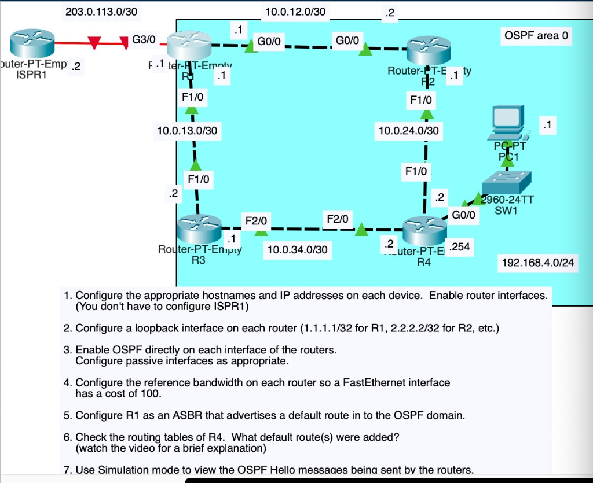
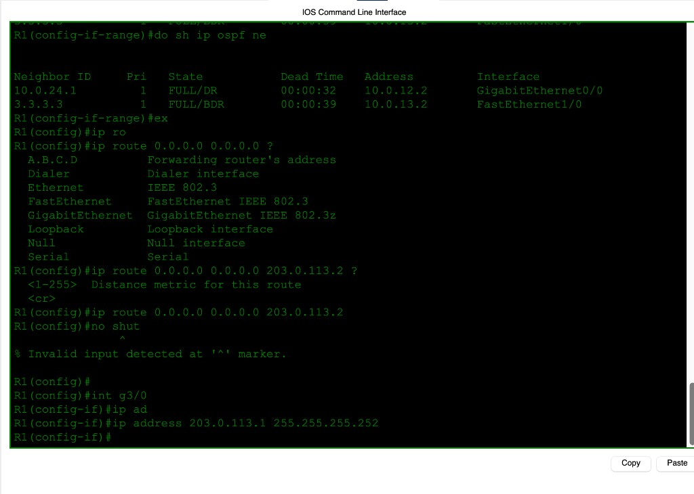
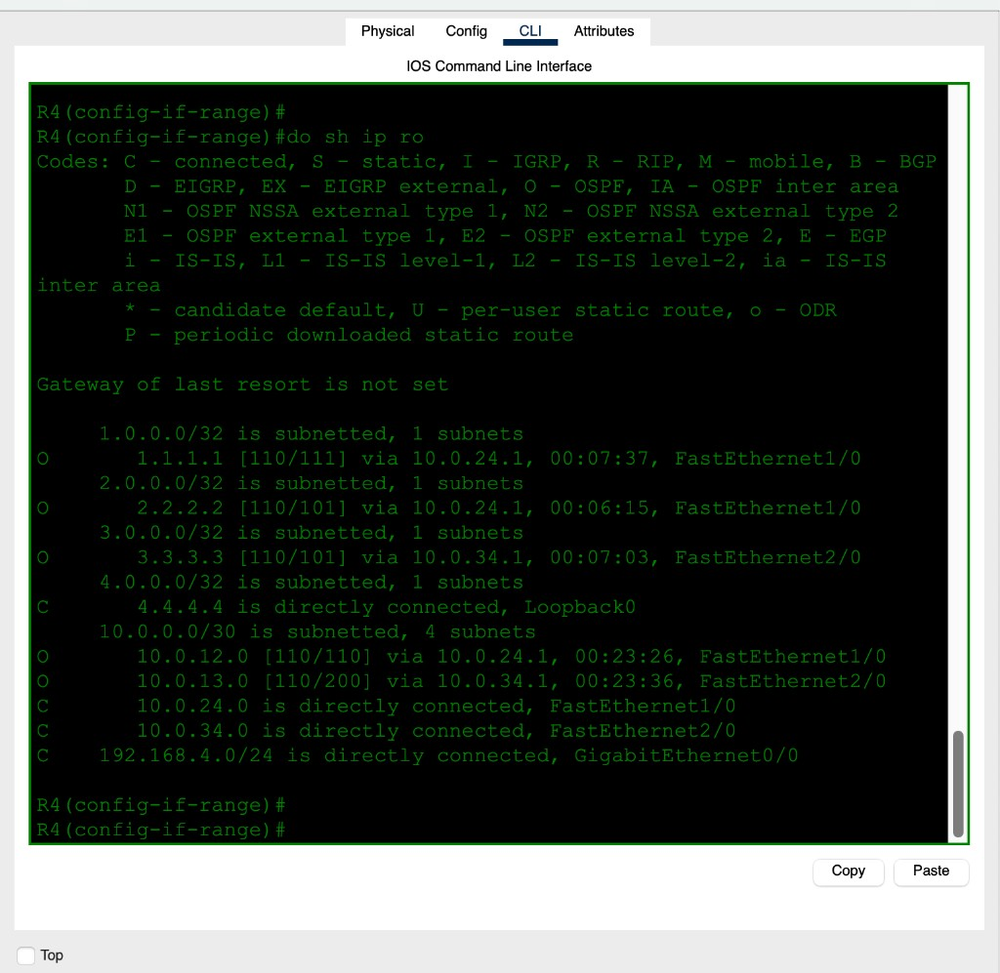

# Day 27 — OSPF (Part 2)

**Topic:** OSPFv2 single-area config — interface enable, passive, reference-bandwidth, ASBR default
**Simulator:** Cisco Packet Tracer — `Day 27 Lab - OSPF (Part 2).pkt`
**Course reference:** Jeremy's IT Lab — CCNA 200-301, Day 27 (OSPF configuration)

---

## 🎯 Objective

> Same square as [Day 26](../day-26-ospf-part-1/). Enable OSPF **on each interface** (`ip ospf 1 area 0`). Raise **reference bandwidth** so FastEthernet costs **100**. R1 is the **ASBR**: static default toward ISPR1 plus `default-information originate`. R4 should then show **one** `O*E2` default — via R2, not R3.

## 🗺️ Topology

OSPF area 0 (cyan). ISPR1 is outside; do not configure it.

| Link | Subnet | IPs |
|------|--------|-----|
| R1 G0/0 ↔ R2 G0/0 | `10.0.12.0/30` | `.1` / `.2` |
| R1 F1/0 ↔ R3 F1/0 | `10.0.13.0/30` | `.1` / `.2` |
| R2 F1/0 ↔ R4 F1/0 | `10.0.24.0/30` | `.1` / `.2` |
| R3 F2/0 ↔ R4 F2/0 | `10.0.34.0/30` | `.1` / `.2` |
| R4 G0/0 ↔ SW1 / PC1 | `192.168.4.0/24` | R4 `.254`, PC1 `.1` |
| R1 G3/0 ↔ ISPR1 | `203.0.113.0/30` | R1 `.1`, ISPR1 `.2` |
| Loopbacks | `/32` | R1 `1.1.1.1` … R4 `4.4.4.4` |



## 🧠 Lesson

Enable OSPF **on the interface** (`ip ospf 1 area 0`). That is what the lab means by “directly on each interface.” Loopbacks and the access LAN should be **passive** (advertise the prefix, send no Hellos). R1’s ISP link stays **out** of OSPF.

Default OSPF reference bandwidth is **100 Mbps**, so FE and GE both cost **1**. Task 4 wants FE cost **100**:

```
auto-cost reference-bandwidth 10000
```

Cost = 10000 / bandwidth-in-Mbps → FE **100**, GE **10**, loopback **1**.

R1 injects a default with `default-information originate` only if it **already has** a default (`S* via 203.0.113.2`). Internal routers install it as **`O*E2`** (external type 2, metric **1** does not grow). Path **to the ASBR** still uses intra-area cost, so R4 prefers **R2** (GE+FE = 110) over **R3** (two FEs = 200).

## 🛠️ Configuration

### Addressing + loopbacks (R1 example)

```
hostname R1
interface loopback 0
 ip address 1.1.1.1 255.255.255.255
interface g0/0
 ip address 10.0.12.1 255.255.255.252
 no shutdown
interface f1/0
 ip address 10.0.13.1 255.255.255.252
 no shutdown
interface g3/0
 ip address 203.0.113.1 255.255.255.252
 no shutdown
```

### OSPF on each interface + passive + ref-bw

```
router ospf 1
 auto-cost reference-bandwidth 10000
 passive-interface loopback 0

interface loopback 0
 ip ospf 1 area 0
interface g0/0
 ip ospf 1 area 0
interface f1/0
 ip ospf 1 area 0
```

R4 also: `passive-interface g0/0` (PC LAN). Do **not** enable OSPF on R1 G3/0.

### R1 as ASBR

```
ip route 0.0.0.0 0.0.0.0 203.0.113.2
router ospf 1
 default-information originate
```

`ip route 0.0.0.0 0.0.0.0 g3/0` also works on this Ethernet; the save uses next-hop **203.0.113.2**.




## 📐 Routing tables

### Before the default (R4)

Loopbacks and `/30`s are in via OSPF. **No** gateway of last resort.



Costs match ref-bw 10000, e.g. `10.0.12.0 [110/110]` (FE 100 + GE 10), `10.0.13.0 [110/200]` (two FEs).

### After originate


**Q6 — What default(s) did R4 add?** One: `O*E2 0.0.0.0/0 [110/1] via 10.0.24.1, FastEthernet1/0`. Not two equal defaults. E2 metric stays 1; the **forwarding** choice is the cheaper path to R1, which is through R2.

R1 neighbors in the capture: `10.0.24.1` FULL/DR on G0/0, `3.3.3.3` FULL/BDR on F1/0 (RIDs follow whatever was up when OSPF started — set `router-id` if you want `1.1.1.1` / `2.2.2.2`).

## ✅ Verification

| Check | Expected |
|-------|----------|
| `show ip ospf neighbor` | FULL on every internal link |
| `show ip ospf interface brief` | FE cost 100, GE cost 10 |
| `show ip ospf` on R1 | 2 interfaces in area 0 (not G3/0) |
| R4 before originate | no `S*` / `O*E2` |
| R4 after | **one** `O*E2` via `10.0.24.1` |
| Simulation Hellos | type 1; RID, area, timers, neighbors |

## 💡 What I learned

`ip ospf 1 area 0` on the interface is enough — no `network` wildcard. Passive on loopbacks and access LANs stops useless Hellos. Default ref-bw hides the FE vs GE difference; `10000` makes FE cost 100. An ASBR default is **E2** (metric 1 everywhere) but you still pick the **closest ASBR path** by intra-area cost — that is why R4’s default goes via R2 only. Originate does nothing until R1 itself has a default to advertise.

## 📎 Files in this lab

- `README.md` — this writeup
- `day27-ospf-part-2.pkt` — Packet Tracer save
- `day27-topology.png` — tasks + addressing (main photo)
- `day27-r1-neighbors.png` / `day27-r1-originate.png` / `day27-r1-routes.png`
- `day27-r2-routes.png` / `day27-r3-routes.png`
- `day27-r4-before-default.png` / `day27-r4-default.png`
