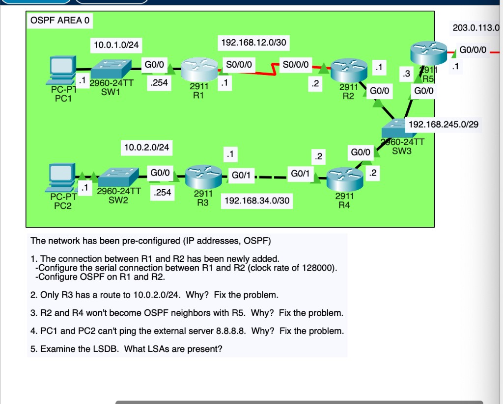
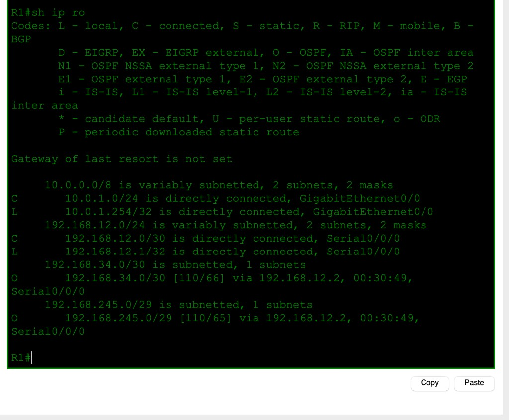
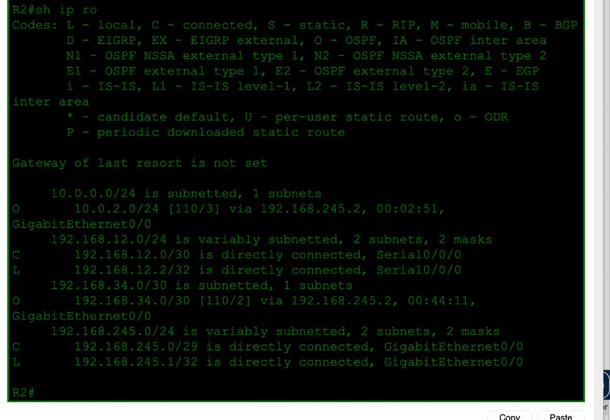
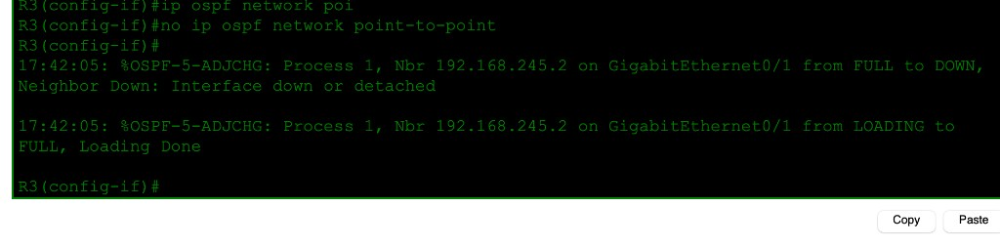
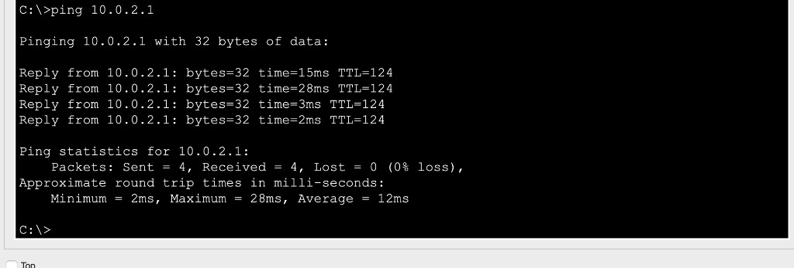
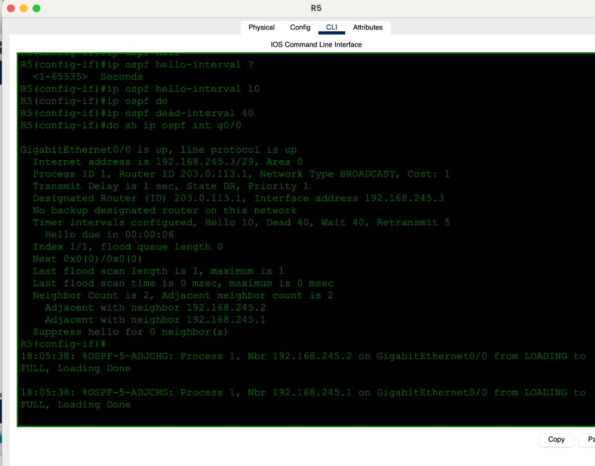
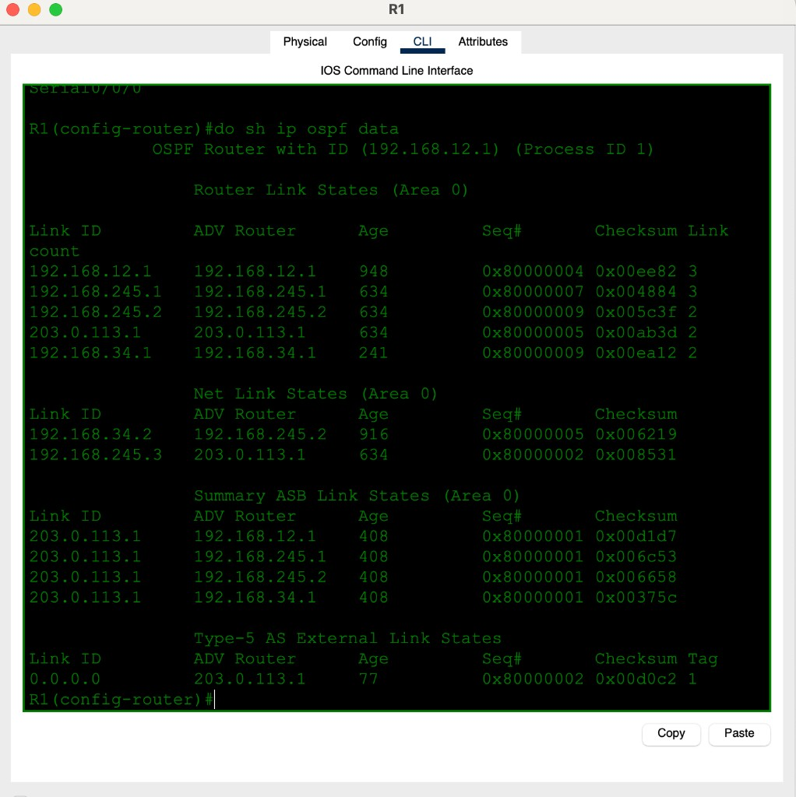

# Day 28 — OSPF (Part 3)

**Topic:** Serial OSPF, network types, Hello/Dead timers, ASBR default, LSDB
**Simulator:** Cisco Packet Tracer — `Day 28 Lab - OSPF (Part 3).pkt`
**Course reference:** Jeremy's IT Lab — CCNA 200-301, Day 28 (OSPF network types / LSAs)

---

## 🎯 Objective

> The IPs and OSPF are already there — **troubleshoot**. Add the new **serial** between R1 and R2, then fix three breaks: R3–R4 **network type**, R5 **Hello/Dead**, and a missing **default** so PCs can reach `8.8.8.8`. End by reading the **LSDB**.

## 🗺️ Topology

All of OSPF **area 0**. R5’s G0/0/0 faces the Internet (`203.0.113.0`).

| Segment | Network | Devices |
|---------|---------|---------|
| PC1 LAN | `10.0.1.0/24` | PC1 `.1`, R1 G0/0 `.254` |
| PC2 LAN | `10.0.2.0/24` | PC2 `.1`, R3 G0/0 `.254` |
| R1–R2 serial | `192.168.12.0/30` | R1 `.1`, R2 `.2` (clock **128000**) |
| R3–R4 | `192.168.34.0/30` | R3 G0/1 `.1`, R4 G0/1 `.2` |
| Multiaccess (SW3) | `192.168.245.0/29` | R2 `.1`, R4 `.2`, R5 `.3` |



## 1 — Serial R1–R2 + OSPF

```
! DCE side (whichever `show controllers` says)
interface s0/0/0
 ip address 192.168.12.1 255.255.255.252
 clock rate 128000
 ip ospf 1 area 0
 no shutdown
```

Serial OSPF defaults to **point-to-point** (no DR). After this, R1 sees `192.168.245.0/29` and `192.168.34.0/30` via `192.168.12.2`; R2 sees `10.0.1.0/24` the other way.





## 2 — Only R3 has `10.0.2.0/24`. Why?

R3’s LAN is connected, but it was not flooding to the rest of the area. **R3–R4 was OSPF `point-to-point` on Ethernet** while the other side expected **broadcast**. Network-type mismatch → no adjacency → `10.0.2.0/24` stays local.

```
interface g0/1
 no ip ospf network point-to-point
```

Adjacency drops, then comes back **FULL** (neighbor RID `192.168.245.2` = R4). Ethernet is broadcast again, so a **DR** is elected and a Type-2 LSA appears for that segment.




PC1 → PC2 (`10.0.2.1`) then works:



## 3 — R2/R4 will not neighbor with R5. Why?

Hellos must match. R5 was **Hello 5 / Dead 20**; R2 and R4 on the `/29` use Ethernet defaults **10 / 40**.

```
interface g0/0
 ip ospf hello-interval 10
 ip ospf dead-interval 40
```

Then R5 goes FULL with `192.168.245.1` (R2) and `192.168.245.2` (R4). This segment is **BROADCAST**; R5 is **DR** (RID `203.0.113.1`).



## 4 — PC1/PC2 cannot ping `8.8.8.8`. Why?

Nobody had a **default**. R5 is the ASBR (ISP on G0/0/0) but until it has a default **and** originates it, internal routers have no path to `8.8.8.8`.

```
ip route 0.0.0.0 0.0.0.0 203.0.113.2
router ospf 1
 default-information originate
```

`ip route 8.8.8.8 0.0.0.0 …` is an illegal mask. After originate, R1 shows a gateway of last resort via `192.168.12.2` and learns R5’s loopback `5.5.5.5/32`.


## 5 — What LSAs are in the LSDB?

`show ip ospf database` on R1:



| Section | LSA | What it is here |
|---------|-----|-----------------|
| Router Link States | **Type 1** | One per router: R1 `192.168.12.1`, R2 `192.168.245.1`, R3 `192.168.34.1`, R4 `192.168.245.2`, R5 `203.0.113.1` |
| Net Link States | **Type 2** | DR-only, broadcast segments: `192.168.34.2` (R3–R4) and `192.168.245.3` (the `/29`, DR = R5) |
| Summary ASB | **Type 4** | How to reach ASBR `203.0.113.1` |
| Type-5 AS External | **Type 5** | `0.0.0.0` advertised by R5 — the originated default |

Point-to-point serial does **not** get a Type-2 (no DR). That is why there is no Net LSA for `192.168.12.0/30`.

## ✅ Verification

| Check | Expected |
|-------|----------|
| `show ip ospf neighbor` | R1–R2 FULL on serial; R3–R4 FULL; R2/R4/R5 FULL on `/29` |
| `show ip ospf interface` | Serial = POINT_TO_POINT; G0/0 `/29` = BROADCAST, Hello 10 Dead 40 |
| R4 `show ip route` | `O 10.0.2.0/24` via `192.168.34.1` |
| R1 | gateway of last resort via `192.168.12.2`; Type-5 `0.0.0.0` in LSDB |
| PC1 ping `10.0.2.1` / `8.8.8.8` | success |

## 💡 What I learned

OSPF neighbors are picky: **network type** and **Hello/Dead** have to match or you stay stuck in DOWN/INIT and prefixes never flood. Ethernet should be **broadcast** (DR + Type-2); serial is **point-to-point** (no DR). A default for the PCs is not magic — the ASBR needs a static default **and** `default-information originate`, which shows up as a **Type-5** `0.0.0.0`. The LSDB is the proof: Type 1 = routers, Type 2 = broadcast segments, Type 5 = externals.

## 📎 Files in this lab

- `README.md` — this writeup
- `day28-ospf-part-3.pkt` — Packet Tracer save
- `day28-topology.png` — tasks (main photo)
- `day28-r1-routes.png` / `day28-r2-routes.png` — after the serial
- `day28-r3-broadcast.png` / `day28-r4-routes.png` / `day28-pc1-ping.png` — Q2
- `day28-r5-timers.png` — Q3
- `day28-r1-default.png` — Q4
- `day28-lsdb.png` — Q5
