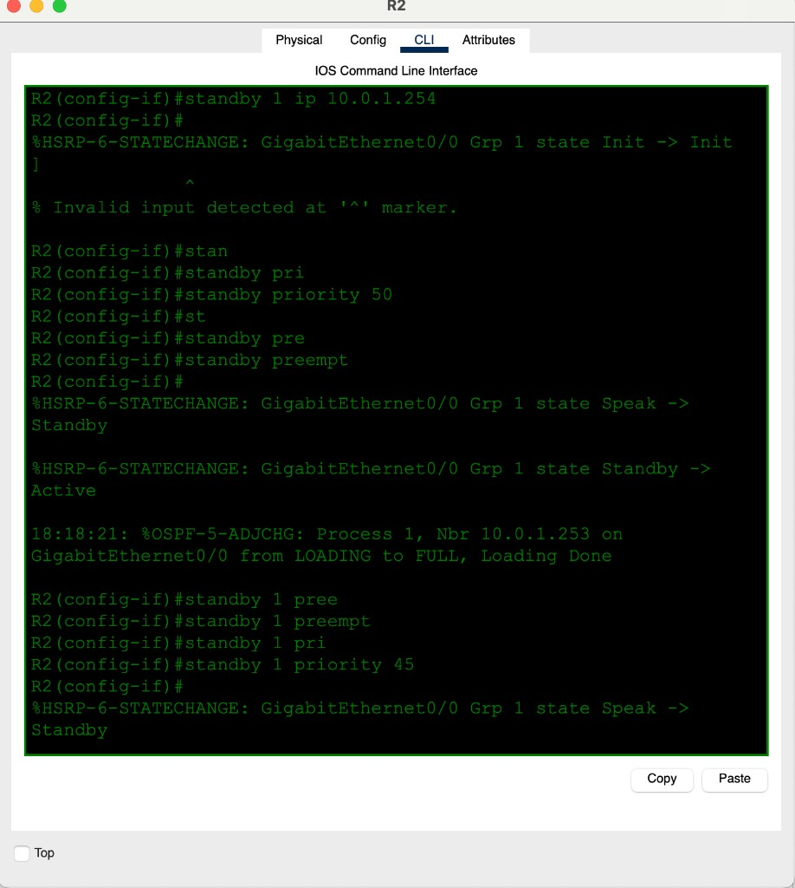
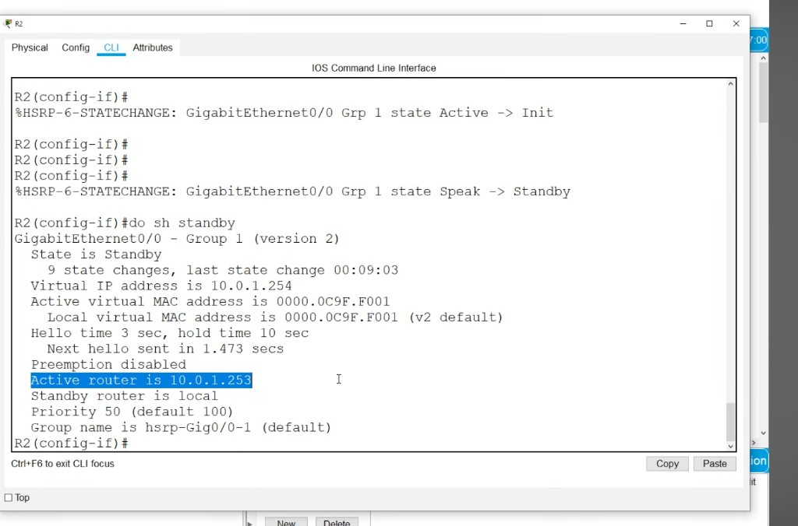
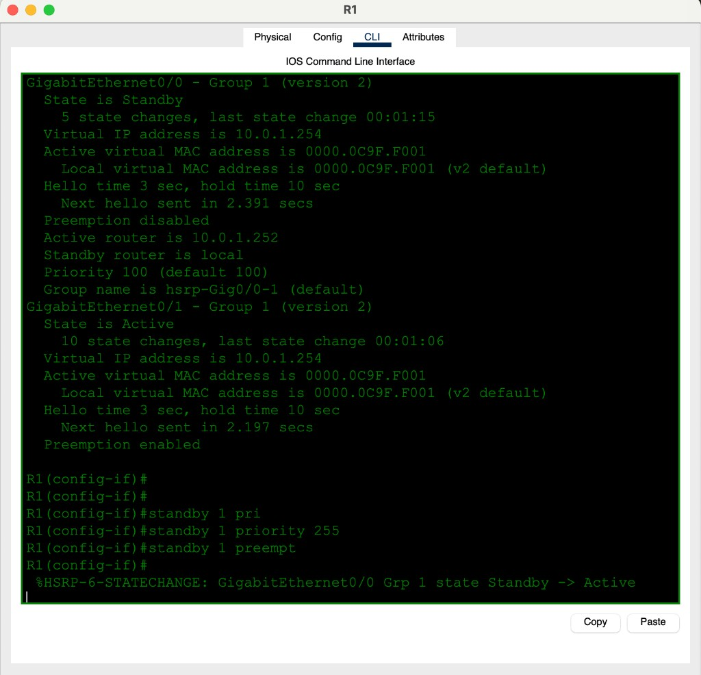
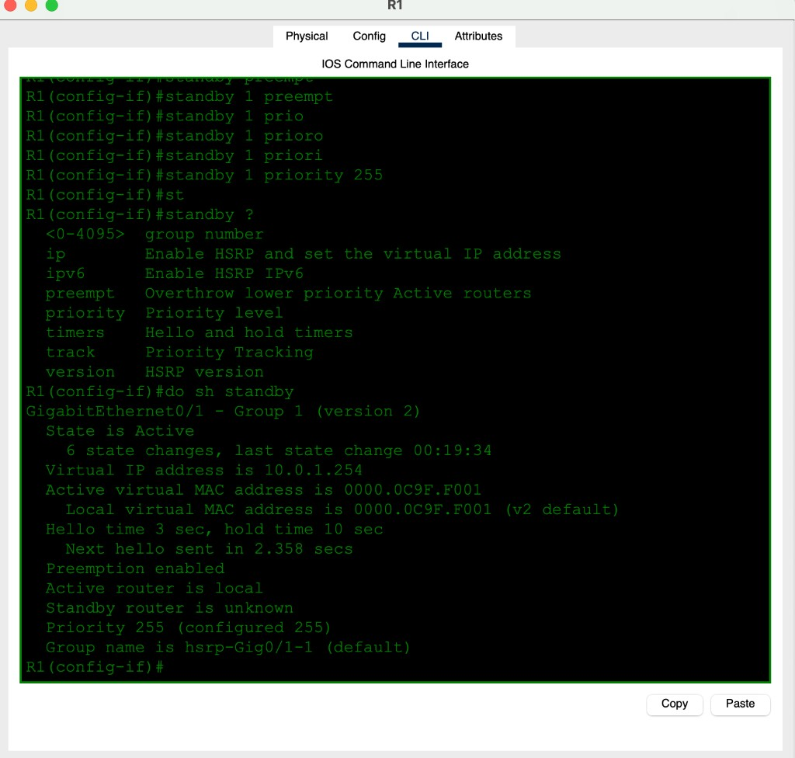
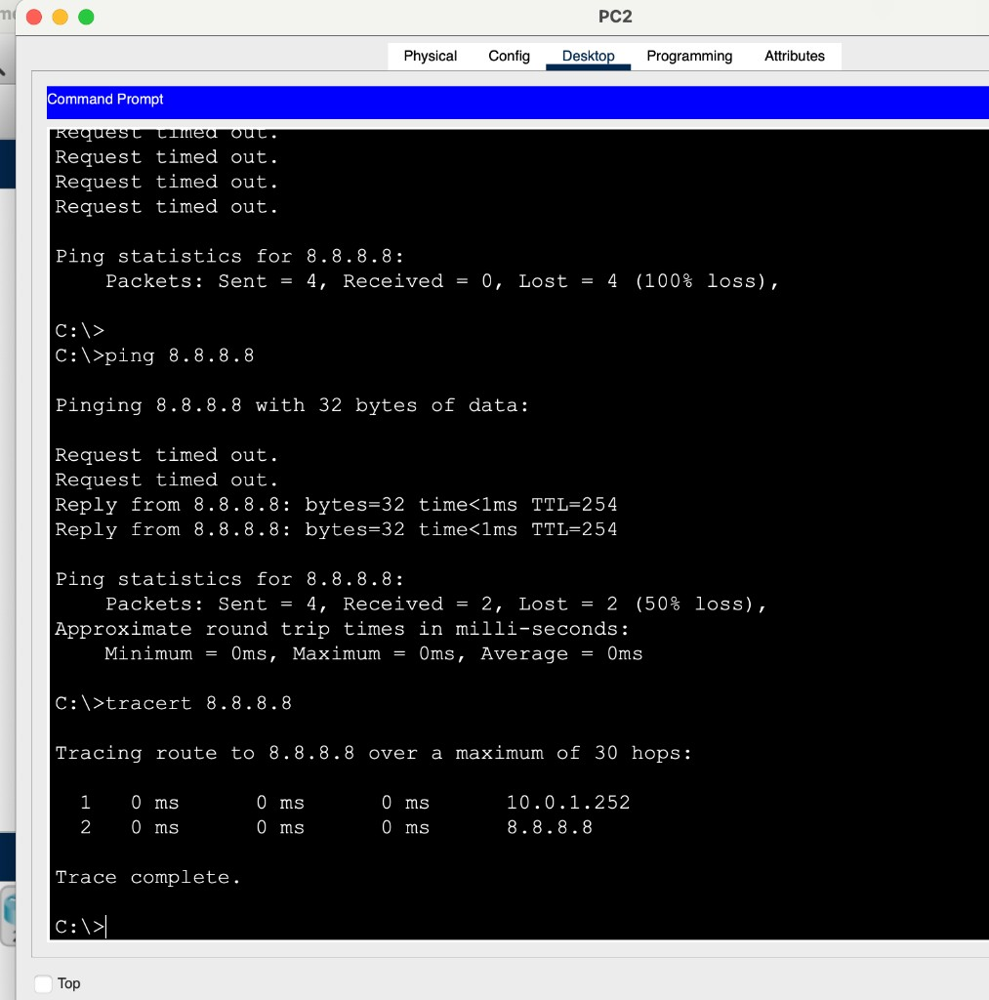
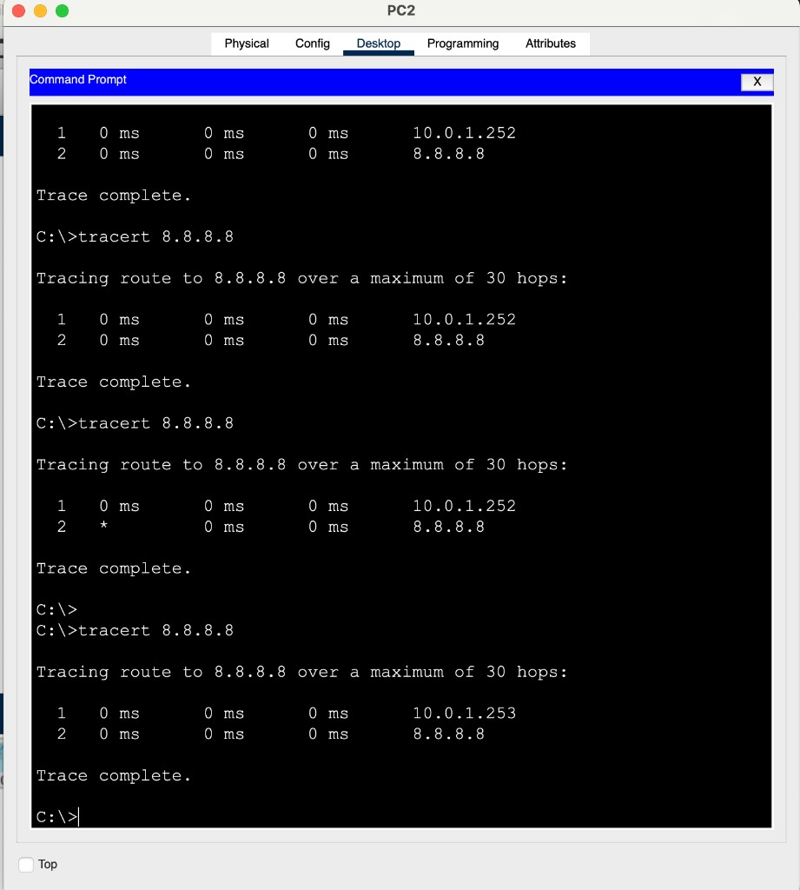

# Day 29 — HSRP Configuration

**Topic:** HSRPv2 — virtual gateway, Active/Standby, priority, preempt
**Simulator:** Cisco Packet Tracer — `Day 29 Lab - HSRP Configuration.pkt`
**Course reference:** Jeremy's IT Lab — CCNA 200-301, Day 29 (FHRP / HSRP)

---

## 🎯 Objective

> Give the PCs **one** default gateway (`10.0.1.254`) that survives a router failure. HSRPv2 group **1** shares that VIP between R1 and R2. Highest **priority** plus **preempt** wins Active. `tracert` hop 1 is whoever currently owns the VIP.

## 🗺️ Addressing (from the CLI)

| Role | Address |
|------|---------|
| LAN | `10.0.1.0/24` |
| Virtual gateway (VIP) | **`10.0.1.254`** |
| R2 G0/0 | `10.0.1.252` |
| R1 G0/0 | `10.0.1.253` (Active IP in the captures) |
| Virtual MAC (v2 group 1) | `0000.0C9F.F001` |
| PC default gateway | `10.0.1.254` |
| Internet test | `8.8.8.8` |

R2’s WAN is `203.0.113.4/30` (`.5` local, default via `.6`).

## 🧠 Lesson

Hosts ARP for **one** gateway MAC. HSRP makes two routers share a **virtual IP + virtual MAC**. Only the **Active** router answers ARP and forwards. The **Standby** takes over if Active hellos stop (hold time 10 s, hello 3 s).

| | HSRPv1 | HSRPv2 (this lab) |
|---|--------|-------------------|
| Multicast | 224.0.0.2 | **224.0.0.102** |
| Virtual MAC | 0000.0C07.ACxx | **0000.0C9F.Fxxx** (group 1 → `…F001`) |
| Group range | 0–255 | 0–4095 |

Default priority is **100**. Higher wins. **Without `preempt`**, a new higher-priority router stays Standby until the current Active fails. That is why R1 (100) sat Standby behind R2 (50) until `standby 1 preempt`.

```
interface g0/0
 standby version 2
 standby 1 ip 10.0.1.254
 standby 1 priority 255
 standby 1 preempt
```

`standby preempt` (no group) is invalid — it must be `standby 1 preempt`.

## 🛠️ Configuration

### R2 — LAN HSRP (physical `.252`)

```
interface g0/0
 standby version 2
 standby 1 ip 10.0.1.254
 standby 1 priority 50
 standby 1 preempt
```

Came up Active first (Speak → Standby → Active), then dropped to Standby after R1 preempted. Later `priority 45` keeps it clearly below R1.





### R1 — take Active with priority + preempt

`show standby` before the change: G0/0 is **Standby**, Active is `10.0.1.252`, priority **100**, **Preemption disabled**. G0/1 is already Active with preempt.

```
interface g0/0
 standby 1 priority 255
 standby 1 preempt
```

`%HSRP-6-STATECHANGE: GigabitEthernet0/0 Grp 1 state Standby -> Active`





## ✅ Failover proof (PC)

First ping to `8.8.8.8` is 100% loss (no Active / ARP). Next run 50% then replies. `tracert` hop 1 is the **current Active physical IP**, not the VIP:

| When | Hop 1 |
|------|--------|
| R2 Active | `10.0.1.252` |
| R1 Active | `10.0.1.253` |

Hop 2 is `8.8.8.8`. Gateway on the PC stays **`.254`** the whole time.






## Verification

| Check | Expected |
|-------|----------|
| `show standby` | v2, group 1, VIP `10.0.1.254`, vMAC `0000.0C9F.F001` |
| R1 after preempt | G0/0 **Active**, pri 255 |
| R2 | **Standby**, Active = `10.0.1.253` |
| PC gateway | `10.0.1.254` (never changes) |
| `tracert 8.8.8.8` | hop 1 = Active router’s physical IP |

## 💡 What I learned

HSRP is a shared VIP so PCs do not care which router is alive. **Priority** picks Active only if **preempt** is on — otherwise whoever became Active first keeps it (R2 at 50 beat R1 at 100). HSRPv2 shows MAC `0000.0C9F.F001` for group 1. `tracert` is the easy way to see who is Active right now. `standby preempt` needs the group number.

## 📎 Files in this lab

- `README.md` — this writeup
- `day29-hsrp.pkt` — Packet Tracer save
- `day29-r1-standby.png` — both interfaces + preempt to Active
- `day29-r1-g0-1.png` / `day29-r2-standby.png` / `day29-r2-config.png`
- `day29-pc-ping.png` / `day29-pc-tracert.png` — failover
- `day29-r2-routes.png`
