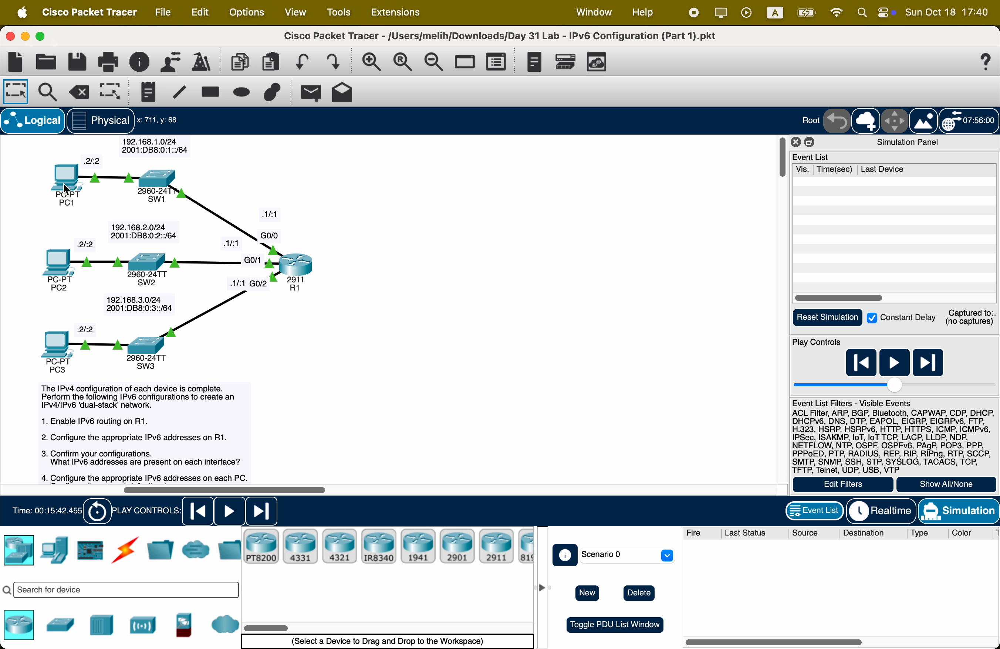
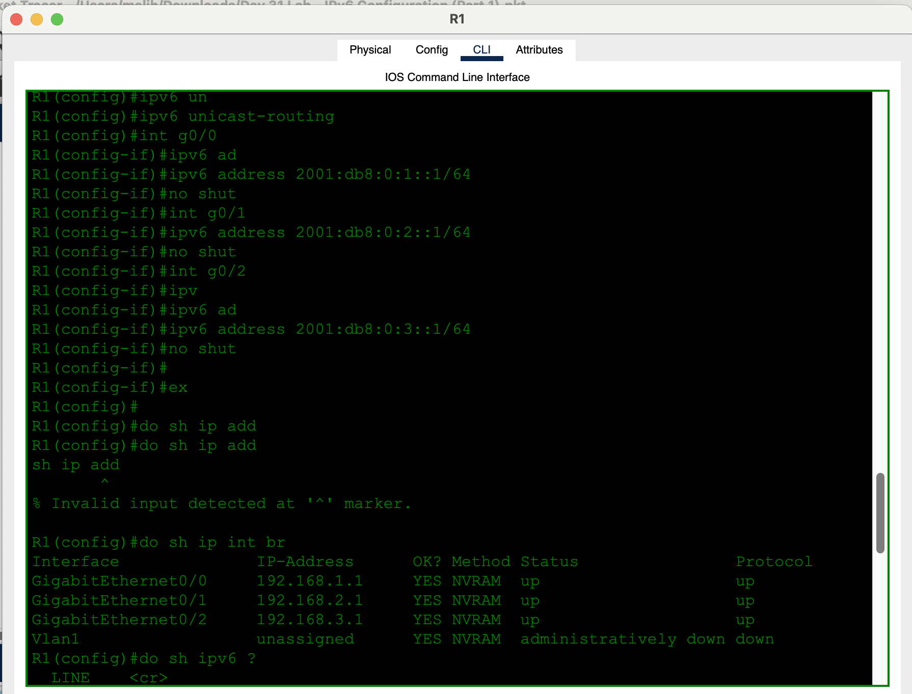
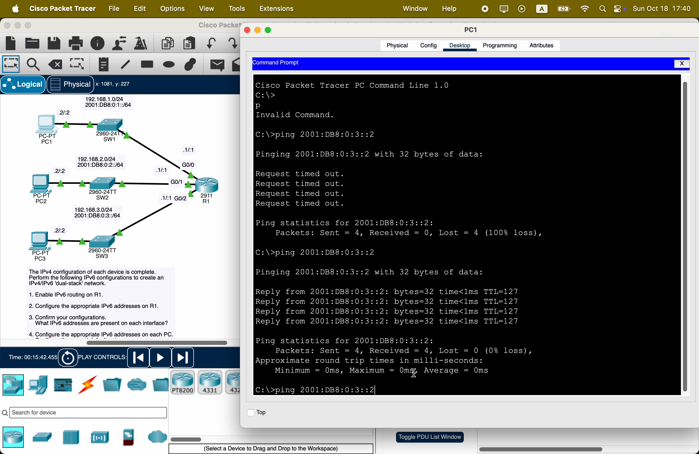

# Day 31 — IPv6 Configuration (Part 1)

**Topic:** Dual-stack — `ipv6 unicast-routing`, global unicast, PC IPv6, ping
**Simulator:** Cisco Packet Tracer — `Day 31 Lab - IPv6 Configuration (Part 1).pkt`
**Course reference:** Jeremy's IT Lab — CCNA 200-301, Day 31 (IPv6 addressing / config)

---

## 🎯 Objective

> IPv4 is already done. Add **IPv6** beside it (dual-stack): turn on IPv6 routing on R1, put a `/64` on each LAN interface, give each PC `::2`, then ping across LANs.

## 🗺️ Topology

One router, three access switches, three PCs. Same L2 links carry IPv4 **and** IPv6.

| LAN | IPv4 | IPv6 `/64` | R1 | PC |
|-----|------|------------|----|-----|
| SW1 / PC1 | `192.168.1.0/24` | `2001:db8:0:1::/64` | G0/0 `.1` / `::1` | `.2` / `::2` |
| SW2 / PC2 | `192.168.2.0/24` | `2001:db8:0:2::/64` | G0/1 `.1` / `::1` | `.2` / `::2` |
| SW3 / PC3 | `192.168.3.0/24` | `2001:db8:0:3::/64` | G0/2 `.1` / `::1` | `.2` / `::2` |



## 🧠 Lesson

Cisco routers do **not** forward IPv6 until:

```
ipv6 unicast-routing
```

Then each interface needs a **global unicast** (and automatically gets a **link-local** `FE80::/10`). `show ip interface brief` still lists **only IPv4**. Use:

```
show ipv6 interface brief
show ipv6 interface g0/0
show ipv6 route
```

`2001:0db8:0000:0001:0000:0000:0000:0001/64` compresses to **`2001:db8:0:1::1/64`**.

## 🛠️ Configuration

### 1–2 — R1 routing + addresses

```
ipv6 unicast-routing
interface g0/0
 ipv6 address 2001:db8:0:1::1/64
 no shutdown
interface g0/1
 ipv6 address 2001:db8:0:2::1/64
 no shutdown
interface g0/2
 ipv6 address 2001:db8:0:3::1/64
 no shutdown
```



`show ip add` is not a command (`show ip interface brief` / `show ipv6 interface brief`). The IPv4 table still shows `192.168.1.1`–`192.168.3.1` — dual-stack, not a replacement.

### 3 — What IPv6 addresses are on each interface?

After the `ipv6 address` lines, each of G0/0–G0/2 has:

| Kind | Example (G0/0) |
|------|----------------|
| Global unicast | `2001:db8:0:1::1/64` |
| Link-local | `FE80::…/10` (auto, EUI-64 or random) |
| Multicast | `FF02::1` (all-nodes), `FF02::2` (all-routers), solicited-node |

### 4 — PCs

On each PC: IPv6 address `2001:db8:0:X::2/64`, gateway `2001:db8:0:X::1` (X = 1, 2, 3).

PC1 → PC3 (`2001:db8:0:3::2`): first ping can drop on Neighbor Discovery (like ARP); second run is 4/4, TTL 127 (one hop through R1).




## ✅ Verification

| Check | Expected |
|-------|----------|
| `show ipv6 interface brief` | G0/0–G0/2 `[up/up]` with `2001:DB8:0:X::1` and `FE80::…` |
| `show ipv6 route` | three connected `/64`s |
| `show ip int brief` | IPv4 still `192.168.X.1` |
| PC1 `ping 2001:db8:0:3::2` | success after ND |

## 💡 What I learned

IPv6 is extra addresses on the same interfaces, not a new topology. **`ipv6 unicast-routing`** is the IPv6 equivalent of turning forwarding on. Global unicast is what you type; **link-local shows up by itself**. `show ip …` will not list IPv6. First ping across a LAN often fails while NDP resolves, same idea as ARP.

## 📎 Files in this lab

- `README.md` — this writeup
- `day31-ipv6-part-1.pkt` — Packet Tracer save
- `day31-topology.png` — dual-stack topology + tasks (main photo)
- `day31-r1-config.png` — R1 CLI
- `day31-pc1-ping.png` — PC1 → PC3 IPv6 ping
- `day31-ipv6.gif` — screen recording
