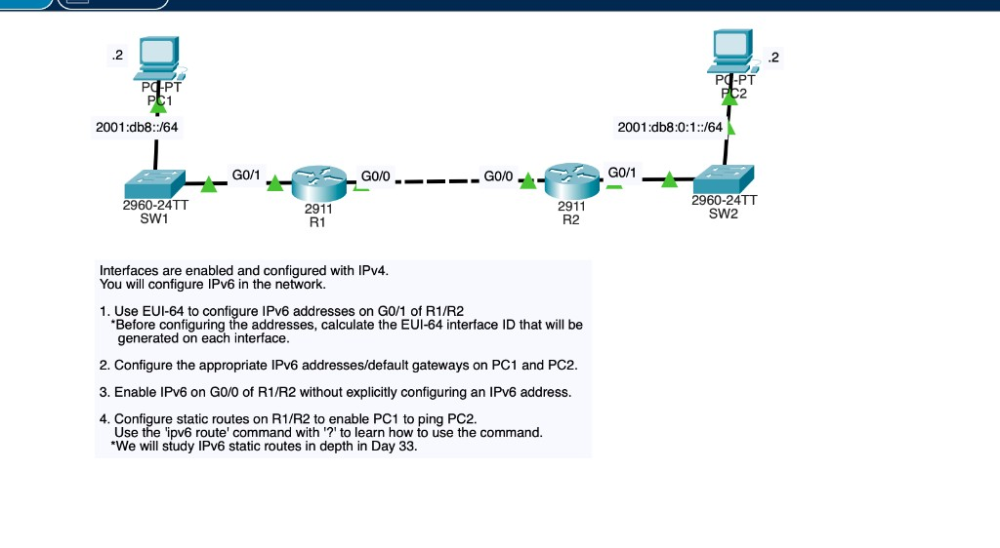
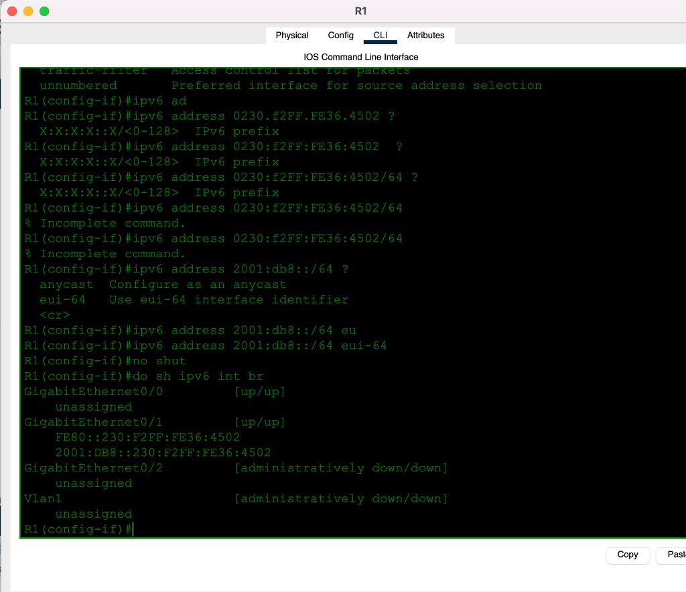
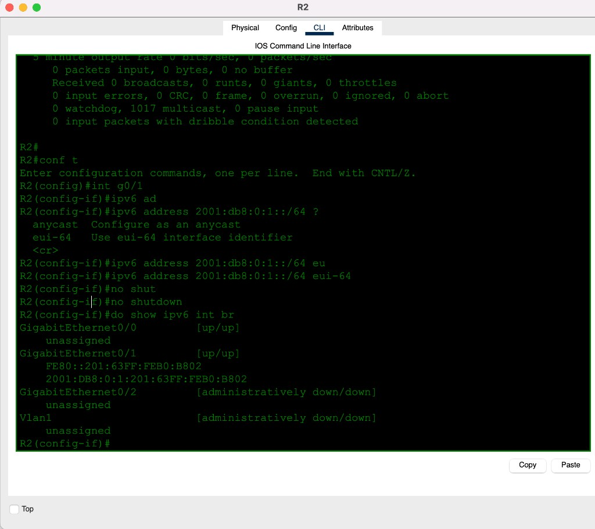
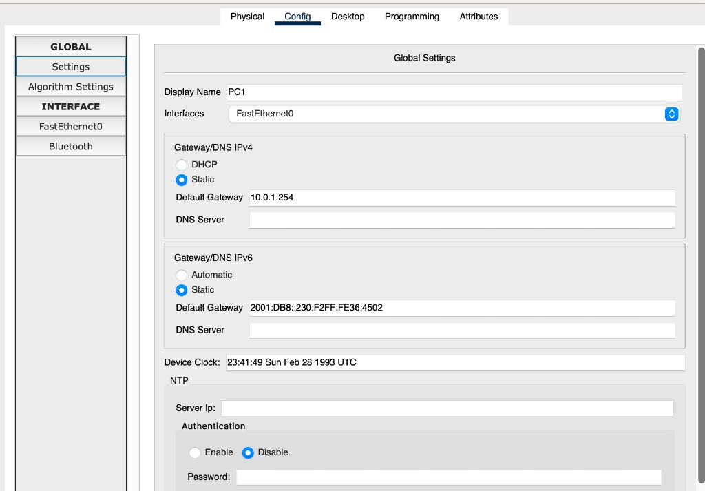
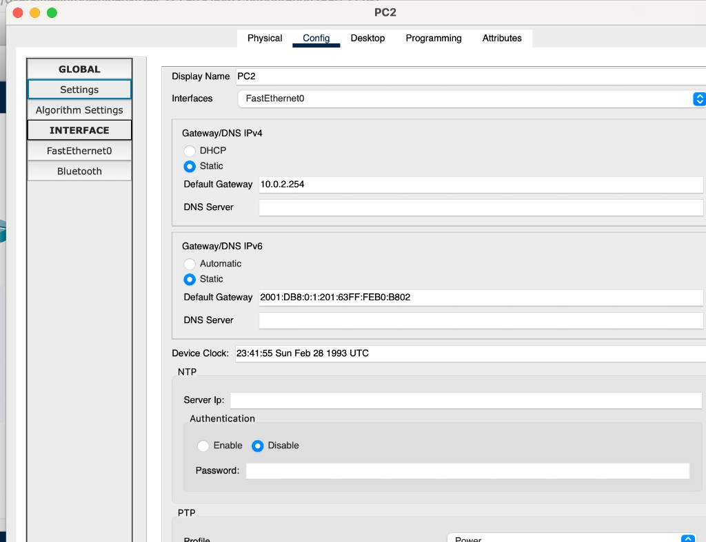
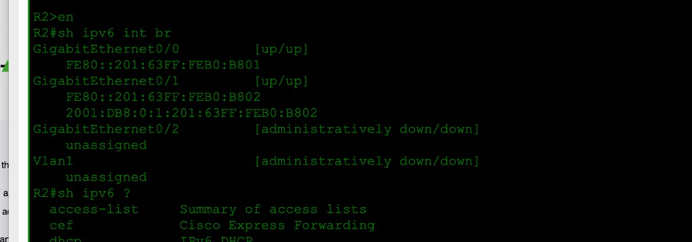
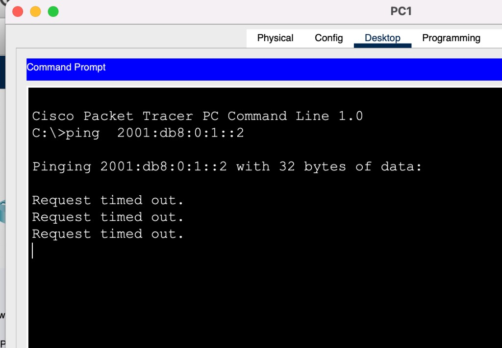

# Day 32 — IPv6 Configuration (Part 2)

**Topic:** EUI-64, `ipv6 enable` (link-local only), IPv6 statics via FE80 next hop
**Simulator:** Cisco Packet Tracer — `Day 32 Lab - IPv6 Configuration (Part 2).pkt`
**Course reference:** Jeremy's IT Lab — CCNA 200-301, Day 32
**Builds on:** [Day 31 — IPv6 Part 1](../day-31-ipv6-part-1/)

---

## 🎯 Objective

> IPv4 is already on. Add IPv6: EUI-64 globals on the LAN sides of R1/R2, addresses + gateways on PC1/PC2, **link-local only** on the R1–R2 link, then static routes so PC1 can ping PC2.

## 🗺️ Topology

PC1 — SW1 — R1 G0/1 ↔ R1 G0/0 — R2 G0/0 ↔ R2 G0/1 — SW2 — PC2

| LAN | Prefix `/64` | Router iface | How the router address is built |
|-----|--------------|--------------|---------------------------------|
| PC1 / SW1 | `2001:db8::/64` | R1 G0/1 | EUI-64 |
| R1–R2 | *(none)* | G0/0 both | `ipv6 enable` → FE80 only |
| PC2 / SW2 | `2001:db8:0:1::/64` | R2 G0/1 | EUI-64 |

PCs are `.2` on the diagram. Gateways are the routers' **EUI-64 globals**, not `::1`.



## 🧠 Lesson

**EUI-64** turns a 48-bit MAC into a 64-bit interface ID:

1. Split the MAC in half.
2. Insert `FFFE` in the middle.
3. Flip the **U/L bit** (7th bit of the first byte): `00` → `02`.

`ipv6 address PREFIX/64 eui-64` also auto-creates a matching **link-local** `FE80::` + that same IID.

`ipv6 enable` on an interface with no global: link-local only. That is enough to be a next hop.

An IPv6 static whose next hop is **link-local** must name the **exit interface** — FE80 addresses are not unique network-wide.

```
ipv6 route PREFIX/LEN FE80::NEXT-HOP GigabitEthernet0/0
```

`ipv6 unicast-routing` is still required to forward.

## 🛠️ Configuration

### 1 — EUI-64 on G0/1 (calculate first)

R1 G0/1 MAC `0030.F236.4502` → IID `230:F2FF:FE36:4502`

```
ipv6 unicast-routing
interface g0/1
 ipv6 address 2001:db8::/64 eui-64
 no shutdown
```

Typing the MAC (or the IID) as if it were a full IPv6 address is **incomplete** — IOS wants `PREFIX/LEN` plus `eui-64` (or a full 128-bit address).



R2 G0/1 MAC `0001.63B0.B802` → IID `201:63FF:FEB0:B802`

```
ipv6 unicast-routing
interface g0/1
 ipv6 address 2001:db8:0:1::/64 eui-64
 no shutdown
```



| Device | Global unicast | Link-local |
|--------|----------------|------------|
| R1 G0/1 | `2001:DB8::230:F2FF:FE36:4502` | `FE80::230:F2FF:FE36:4502` |
| R2 G0/1 | `2001:DB8:0:1:201:63FF:FEB0:B802` | `FE80::201:63FF:FEB0:B802` |

### 2 — PCs

| PC | IPv6 `/64` | Default gateway (router EUI-64) |
|----|------------|----------------------------------|
| PC1 | `2001:DB8::2` | `2001:DB8::230:F2FF:FE36:4502` |
| PC2 | `2001:DB8:0:1::2` | `2001:DB8:0:1:201:63FF:FEB0:B802` |







### 3 — G0/0: enable IPv6, no global

```
interface g0/0
 ipv6 enable
 no shutdown
```

R2 G0/0 after that: **`FE80::201:63FF:FEB0:B801` only** (same chassis as G0/1, last nibble `1` vs `2`). No `2001:DB8:…` on this link.



### 4 — Statics so PC1 can reach PC2

`ipv6 route ?` → prefix, then next-hop **or** exit interface.


With a link-local next hop, **both**:

```
! R1 — remote LAN via R2
ipv6 route 2001:db8:0:1::/64 FE80::201:63FF:FEB0:B802 GigabitEthernet0/0

! R2 — remote LAN via R1
ipv6 route 2001:db8::/64 FE80::230:F2FF:FE36:4502 GigabitEthernet0/0
```

Day 33 covers IPv6 statics in depth. Next hop here is the neighbor's FE80; the outgoing interface is G0/0.

Ping **before** the statics times out:



After:


## ✅ Verification

| Check | Expected |
|-------|----------|
| `show ipv6 interface brief` (LAN) | G0/1 `[up/up]` with `2001:DB8:…` **and** `FE80::…` |
| `show ipv6 interface brief` (G0/0) | `FE80::…` only — no global |
| PC1 / PC2 | `::2/64`, gateway = router EUI-64 |
| `show ipv6 route` on R1 | `C 2001:DB8::/64` G0/1 · `S 2001:DB8:0:1::/64` via FE80, G0/0 |
| `show ipv6 route` on R2 | `S 2001:DB8::/64` via FE80, G0/0 · `C 2001:DB8:0:1::/64` G0/1 |
| PC1 `ping 2001:db8:0:1::2` | fails until statics exist |

## 💡 What I learned

EUI-64 is not a prefix you type — it is **MAC → IID** (`FFFE` + U/L flip) glued onto the `/64`. That same IID shows up on `FE80::` as well, so the PC gateway is a long EUI-64 global, not `::1`. **`ipv6 enable`** is how you bring IPv6 up with **no** global (the R1–R2 link). Statics to an FE80 next hop always need the **exit interface**. Without those routes, PC1→PC2 times out even though both LANs have IPv6.

## 📎 Files in this lab

- `README.md` — this writeup
- `day32-ipv6-part-2.pkt` — Packet Tracer save
- `day32-topology.png` — topology + tasks (main photo)
- `day32-r1-eui64.png` / `day32-r2-eui64.png` — EUI-64 on G0/1
- `day32-r2-ll.png` — G0/0 link-local only
- `day32-pc1.png` / `day32-pc1-gw.png` / `day32-pc2.png` / `day32-pc2-gw.png`
- `day32-r1-route-help.png` / `day32-r1-routes.png` / `day32-r2-routes.png`
- `day32-pc1-ping.png` — ping before statics
