# Day 34 — Standard ACLs

**Topic:** Standard numbered + named ACLs, closest-to-destination, OSPF for reachability
**Simulator:** Cisco Packet Tracer — `Day 34 Lab - Standard ACLs.pkt`
**Course reference:** Jeremy's IT Lab — CCNA 200-301, Day 34 (Standard Access Control Lists)

---

## 🎯 Objective

> Turn on **OSPF** so every PC can reach both servers, then lock the network down with **standard ACLs** (source IP only): numbered lists on R1, named lists on R2.

## 🗺️ Topology

Two sites over `203.0.113.0/30`. Gateways are `.254`. Servers are `.100`.

| Device | LAN | Address |
|--------|-----|---------|
| PC1 | `172.16.1.0/24` → R1 G0/0 | `.1` |
| PC2 | `172.16.1.0/24` → R1 G0/0 | `.2` |
| PC3 | `172.16.2.0/24` → R1 G0/1 | `.1` |
| PC4 | `172.16.2.0/24` → R1 G0/1 | `.2` |
| SRV1 | `192.168.1.0/24` → R2 G0/0 | `.100` |
| SRV2 | `192.168.2.0/24` → R2 G0/1 | `.100` |
| R1 / R2 serial | `203.0.113.0/30` | `.1` / `.2` |

**Policies (one ACL idea per rule):**

1. Only **PC1** and **PC3** can access `192.168.1.0/24`.
2. Hosts in `172.16.2.0/24` cannot access `192.168.2.0/24`.
3. `172.16.1.0/24` cannot access `172.16.2.0/24`.
4. `172.16.2.0/24` cannot access `172.16.1.0/24`.

Standard ACLs that protect a **destination LAN** go **closest to that destination** (R2 for the servers). The two R1 LANs blocking each other go on **R1**.

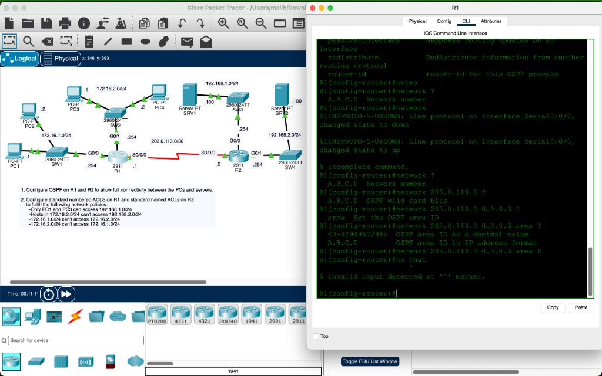

## 🧠 Lesson

A **standard ACL** matches **source** IPv4 only. Numbered: `1–99` / `1300–1999`. Named: `ip access-list standard NAME`.

Implicit **deny any** at the bottom — if you only `permit` the hosts you want, everyone else is dropped.

Wildcard `0.0.0.0` = that one host. Wildcard `0.0.0.255` = the whole `/24`. `permit 172.16.1.1 0.0.0.255` is **not** “only PC1” — it is the entire `172.16.1.0/24`.

`ip access-group {N|NAME} in|out` is per-interface. Outbound on the server LAN is the usual place for “who may reach this subnet.”

## 🛠️ Configuration

### 1 — OSPF (full reachability first)

```
! R1
router ospf 1
 network 172.16.0.0 0.0.255.255 area 0
 network 203.0.113.0 0.0.0.3 area 0

! R2
router ospf 1
 network 192.168.0.0 0.0.255.255 area 0
 network 203.0.113.0 0.0.0.3 area 0
```

Serial is OSPF **point-to-point** (no DR/BDR). R1 learns `192.168.1.0/24` and `192.168.2.0/24`; R2 learns both `172.16` LANs.

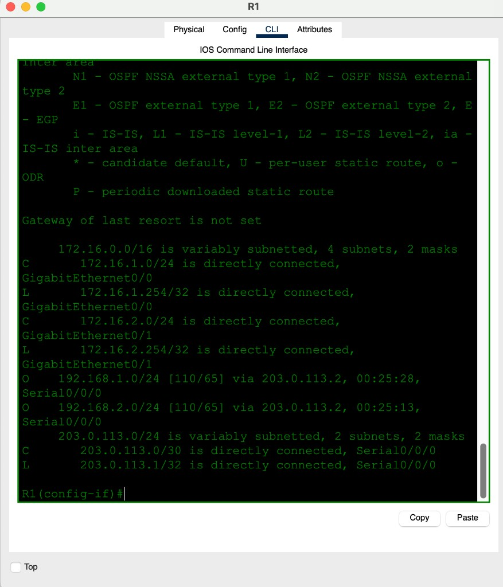

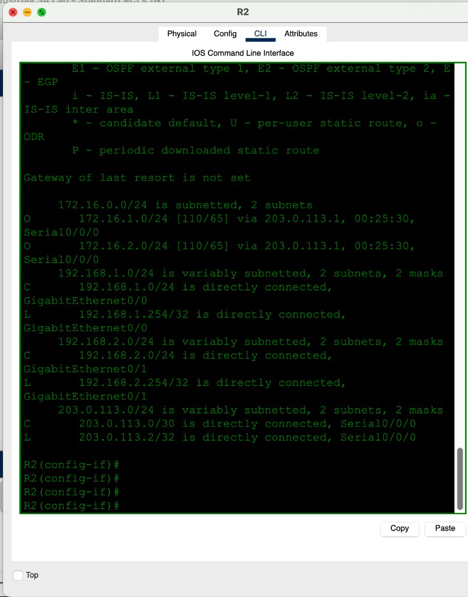

### 2 — R2 named ACLs (closest to the servers)

**TO_SRV1** outbound on G0/0 — who may enter `192.168.1.0/24`. Lab text wants **host** PC1 + PC3 (`0.0.0.0`). This save used `/24` wildcards, so any host in `172.16.1.0/24` or `172.16.2.0/24` matches (PC4 can reach SRV1 too).

```
ip access-list standard TO_SRV1
 permit 172.16.1.0 0.0.0.255
 permit 172.16.2.0 0.0.0.255
! implicit deny any
interface g0/0
 ip access-group TO_SRV1 out
```

Stricter “only PC1 and PC3” version:

```
ip access-list standard TO_SRV1
 permit 172.16.1.1 0.0.0.0
 permit 172.16.2.1 0.0.0.0
```

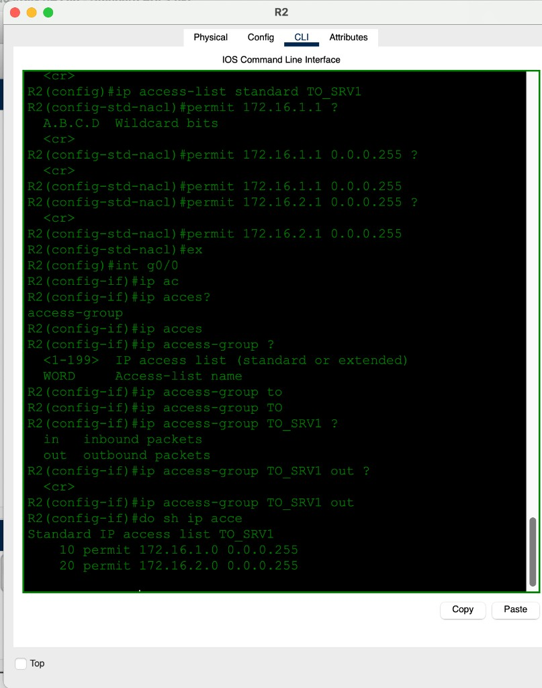

**TO_SRV2** outbound on G0/1 — `172.16.2.0/24` must not reach SRV2; everyone else may.

```
ip access-list standard TO_SRV2
 deny 172.16.2.0 0.0.0.255
 permit any
interface g0/1
 ip access-group TO_SRV2 out
```

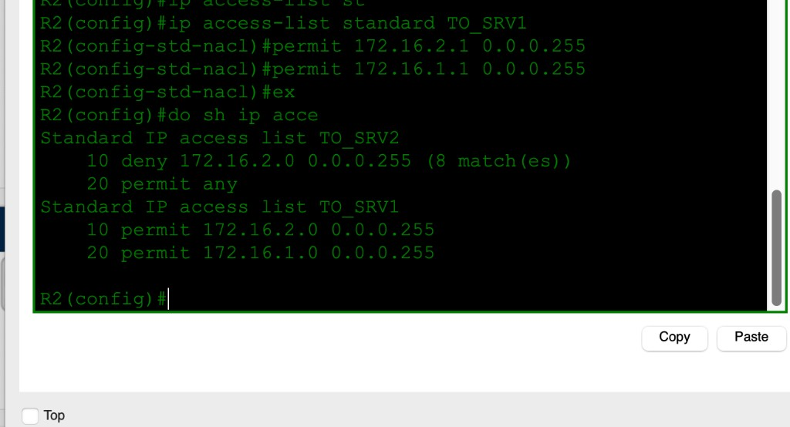

### 3 — R1 numbered ACLs (the two 172.16 LANs)

Standard ACL **1** inbound G0/1 and **2** inbound G0/0 — stop the two campus LANs talking to each other (plus a deny for `192.168.1.0/24` on ACL 1 from the first pass).

```
access-list 1 deny 172.16.1.0 0.0.0.255
access-list 1 deny 192.168.1.0 0.0.0.255
access-list 1 permit any
access-list 2 deny 172.16.2.0 0.0.0.255
access-list 2 permit any
interface g0/0
 ip access-group 2 in
interface g0/1
 ip access-group 1 in
```

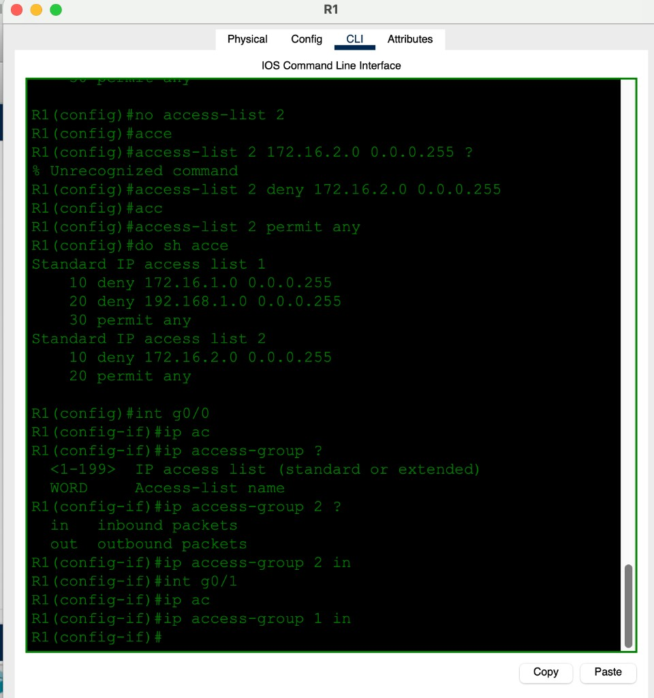


## ✅ Verification

| From | To | Result | Why |
|------|----|--------|-----|
| PC1 | `192.168.1.100` | 4/4 | TO_SRV1 permits `172.16.1.0/24` |
| PC1 | `192.168.2.100` | 3/4 (first drop = ARP/ND-style miss) | TO_SRV2 does not deny `172.16.1.0/24` |
| PC1 | `172.16.2.1` | unreachable from `172.16.1.254` | R1 ACL between the two LANs |
| PC3 | `192.168.1.100` | 4/4 | TO_SRV1 permits `172.16.2.0/24` |
| PC3 | `192.168.2.100` | unreachable from `203.0.113.2` | TO_SRV2 deny `172.16.2.0/24` |
| PC4 | `192.168.1.100` | 4/4 | same `/24` permit as PC3 (not host-only) |
| PC4 | `192.168.2.100` | unreachable from `203.0.113.2` | TO_SRV2 |
| PC2 | `192.168.1.100` / `172.16.2.2` | unreachable | early test / R1 inter-LAN ACL |

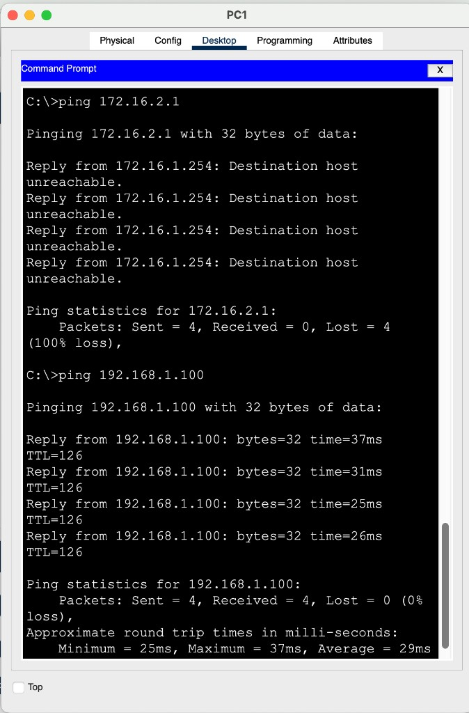

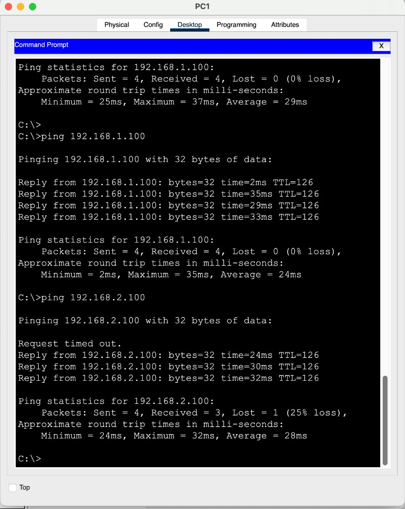

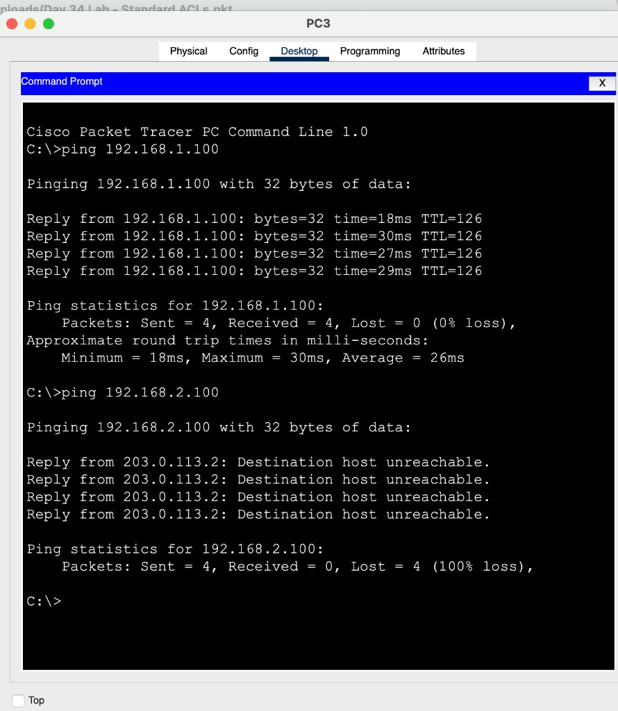

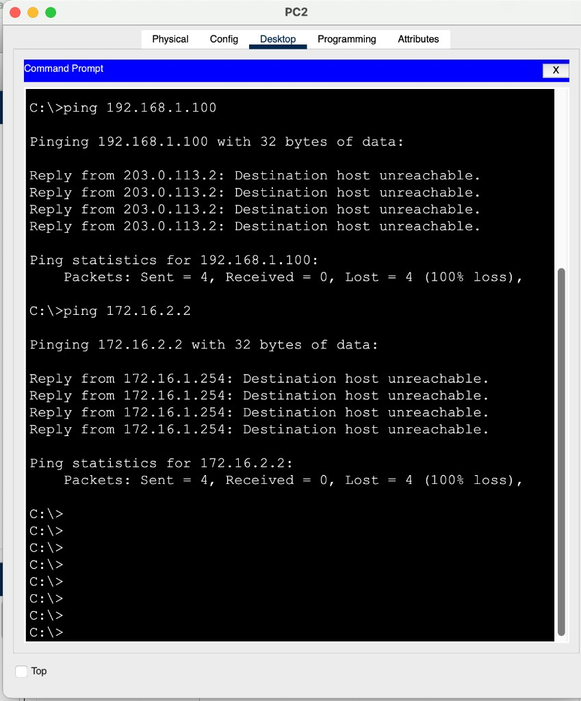

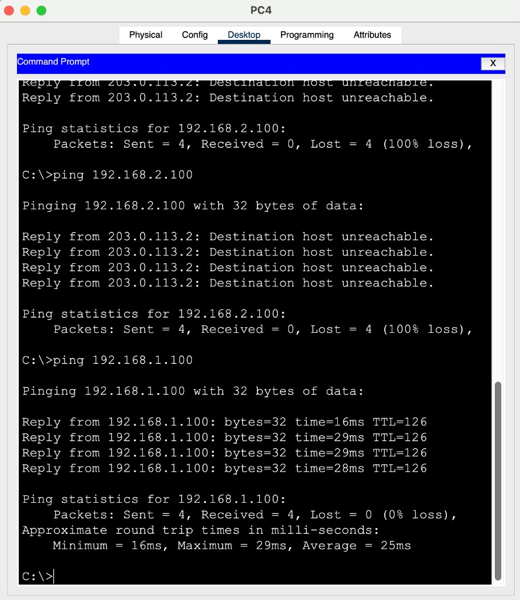

`Destination host unreachable` from the **router** (`172.16.1.254` or `203.0.113.2`) is the ACL drop. A timeout with no ICMP is often “no reply,” not the same as a deny.

## 💡 What I learned

Standard ACLs are **source-only**, so you place them near the **destination** or you accidentally filter too much (or the wrong direction). `in` vs `out` is the whole game on the interface. Wildcard `0.0.0.255` is a `/24` — if the policy says **only PC1 and PC3**, that has to be `0.0.0.0` (host). Implicit deny means a `permit` list does not need a `deny any` at the end. OSPF first, ACLs second — otherwise you cannot tell a routing miss from a filter.

## 📎 Files in this lab

- `README.md` — this writeup
- `day34-standard-acls.pkt` — Packet Tracer save
- `day34-topology.png` — topology + policies (main photo)
- `day34-r1-routes.png` / `day34-r2-routes.png` — OSPF tables
- `day34-r1-acl.png` / `day34-r1-apply.png` — numbered ACLs on R1
- `day34-r2-acl.png` / `day34-r2-named.png` — named ACLs on R2
- `day34-pc1-lan.png` / `day34-pc1-srv.png` / `day34-pc3-srv.png` / `day34-pc2.png` / `day34-pc4.png`
