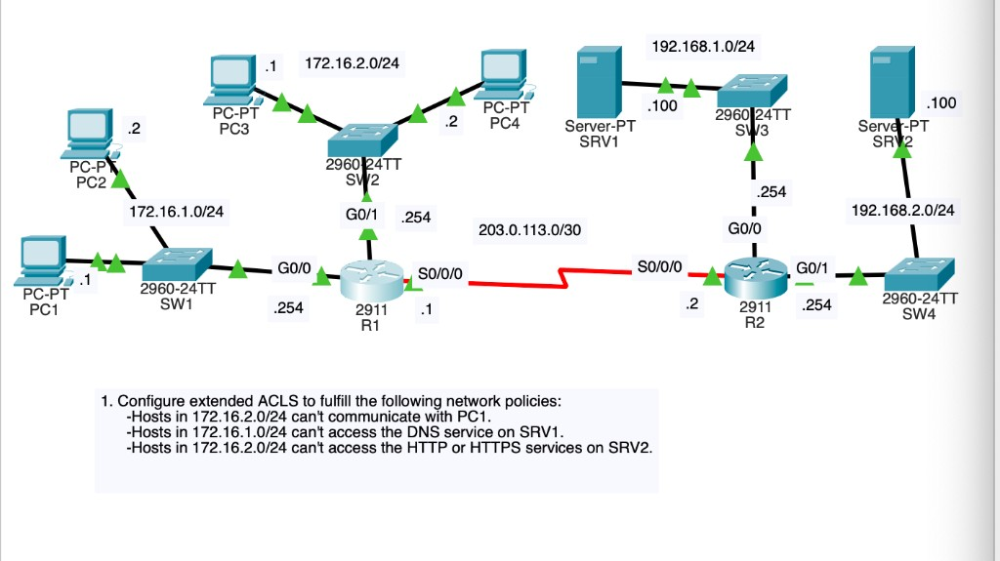
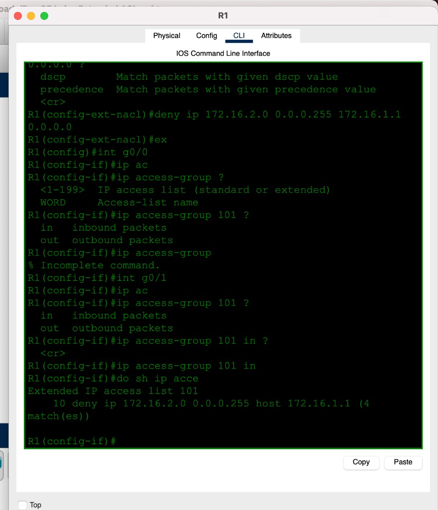
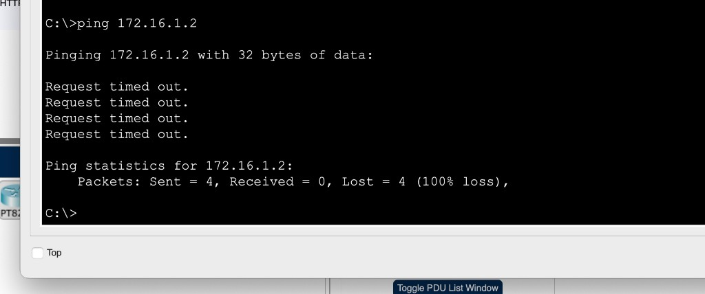
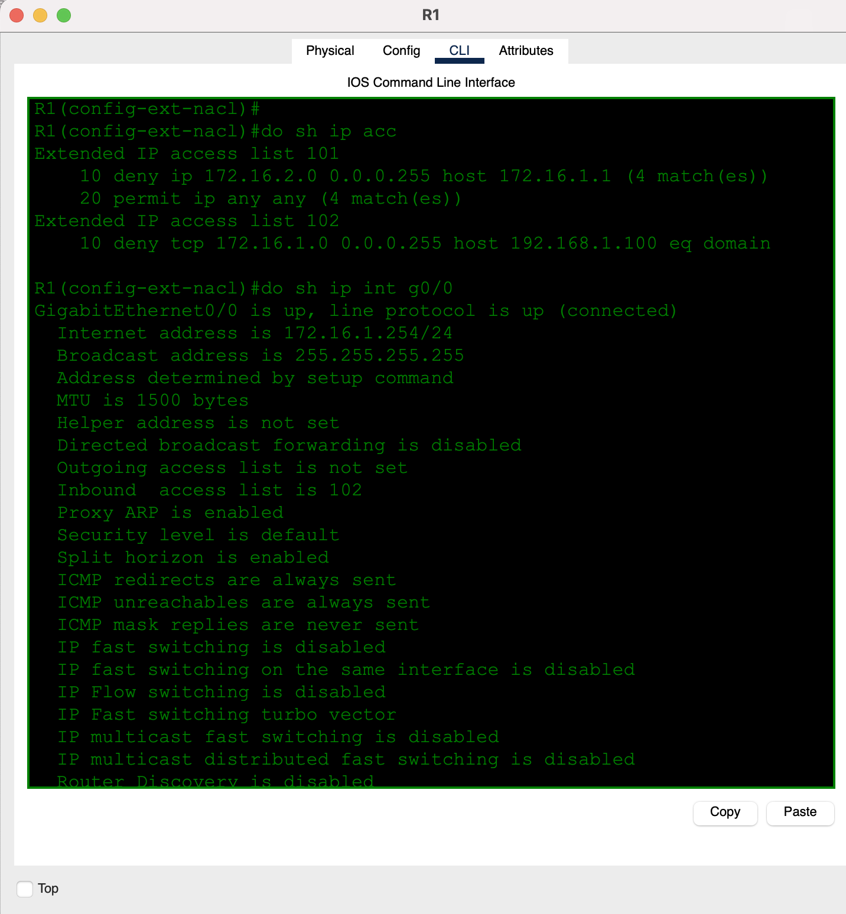
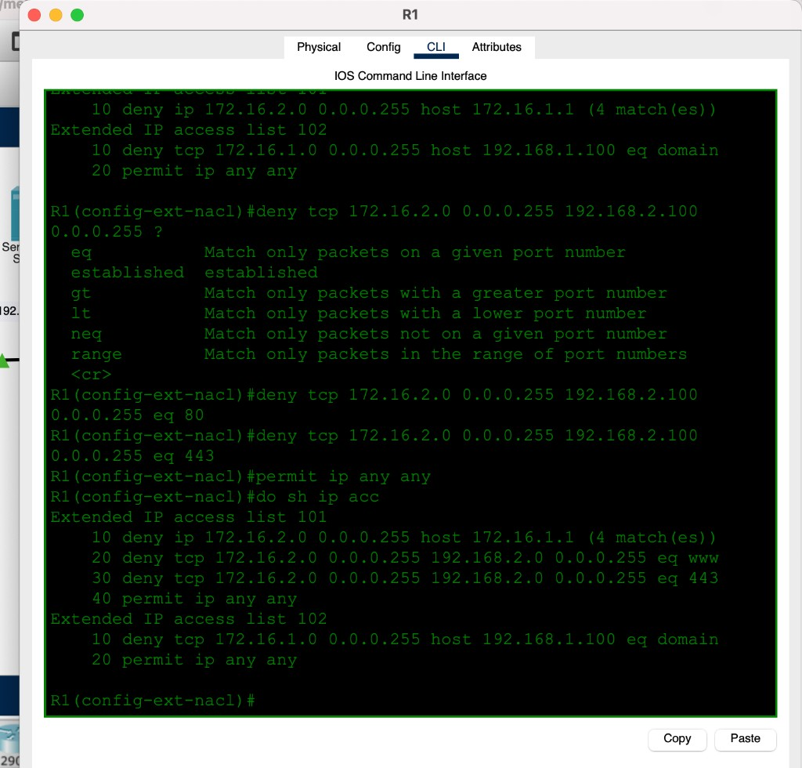

# Day 35 — Extended ACLs

**Topic:** Extended numbered ACLs — protocol, source, dest, TCP/UDP port
**Simulator:** Cisco Packet Tracer — `Day 35 Lab - Extended ACLs.pkt`
**Course reference:** Jeremy's IT Lab — CCNA 200-301, Day 35
**Builds on:** [Day 34 — Standard ACLs](../day-34-standard-acls/)

---

## 🎯 Objective

> Same two-site topology as Day 34. This time **extended** ACLs: match **protocol + source + dest + port**, and place them **closest to the source**.

## 🗺️ Topology

PC1/PC2 on `172.16.1.0/24` (R1 G0/0 `.254`). PC3/PC4 on `172.16.2.0/24` (R1 G0/1 `.254`). Serial `203.0.113.0/30`. SRV1 `192.168.1.100`, SRV2 `192.168.2.100` on R2.

**Policies:**

1. Hosts in `172.16.2.0/24` cannot communicate with **PC1** (`172.16.1.1`).
2. Hosts in `172.16.1.0/24` cannot access **DNS** on SRV1.
3. Hosts in `172.16.2.0/24` cannot access **HTTP or HTTPS** on SRV2.



## 🧠 Lesson

Standard ACL = **source IP only**. Extended = `protocol src dest [port]`.

Numbered extended: **100–199** / **2000–2699**.

```
deny tcp SRC WILD DST WILD eq PORT
permit ip any any
```

`eq domain` = TCP 53, `eq www` = 80, `443` = HTTPS. Operators: `eq` `neq` `gt` `lt` `range`.

Because you can name the **destination**, extended ACLs sit **closest to the source** (you are not blocking that source from the whole rest of the network). Always end a “deny some, allow the rest” list with **`permit ip any any`** — implicit deny would drop everything else.

## 🛠️ Configuration

All three rules live on **R1** (closest source).

### ACL 101 — inbound G0/1 (from `172.16.2.0/24`)

Policies 1 and 3: no IP to PC1; no TCP 80/443 to the SRV2 LAN.

```
ip access-list extended 101
 deny ip 172.16.2.0 0.0.0.255 host 172.16.1.1
 deny tcp 172.16.2.0 0.0.0.255 192.168.2.100 0.0.0.255 eq 80
 deny tcp 172.16.2.0 0.0.0.255 192.168.2.100 0.0.0.255 eq 443
 permit ip any any
interface g0/1
 ip access-group 101 in
```

IOS prints `192.168.2.100 0.0.0.255` as `192.168.2.0/24` (`eq www` / `eq 443`). Host-only SRV2 would be `host 192.168.2.100`.



First version was **only** that deny. Implicit deny then dropped *all* `172.16.2.0/24` traffic (ping to `172.16.1.2` timed out). `permit ip any any` fixed the rest.



### ACL 102 — inbound G0/0 (from `172.16.1.0/24`)

Policy 2: no DNS to SRV1.

```
ip access-list extended 102
 deny tcp 172.16.1.0 0.0.0.255 host 192.168.1.100 eq domain
 permit ip any any
interface g0/0
 ip access-group 102 in
```

`eq domain` is **TCP/53**. Real DNS is often **UDP/53** — a tighter lab would add `deny udp … eq domain` too.





## ✅ Verification

| Check | Expected |
|-------|----------|
| `show ip access-lists` | 101: deny to PC1 + deny tcp 80/443 to `192.168.2.0/24` + permit any · 102: deny tcp domain to SRV1 + permit any |
| `show ip interface g0/0` | inbound **102** |
| `show ip interface g0/1` | inbound **101** |
| PC3/PC4 → `172.16.1.1` | blocked (101 hits) |
| PC3/PC4 → other 172.16.1.x / SRV1 | allowed after `permit any` |
| `172.16.1.0/24` → SRV1 TCP/53 | blocked |
| `172.16.2.0/24` → SRV2 :80 / :443 | blocked |

## 💡 What I learned

Extended ACLs let you pick **who + what + which port**, so you filter next to the **source** instead of the destination. A lone `deny` without **`permit ip any any`** is a black-hole (implicit deny). `eq domain` is TCP 53 only. Wildcard `0.0.0.255` on `192.168.2.100` is the whole `/24`, not “just the server.”

## 📎 Files in this lab

- `README.md` — this writeup
- `day35-extended-acls.pkt` — Packet Tracer save
- `day35-topology.png` — topology + policies (main photo)
- `day35-acl101-apply.png` — ACL 101 inbound G0/1
- `day35-acls.png` — both lists (80/443 + DNS)
- `day35-r1-apply.png` — ACL 102 inbound G0/0
- `day35-ping.png` — implicit-deny ping timeout
