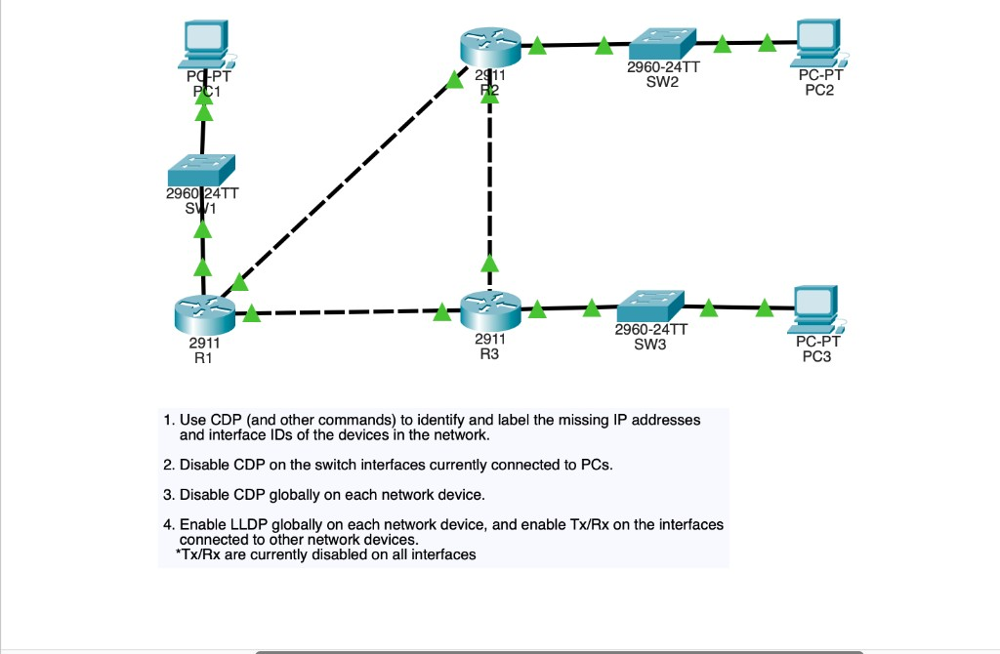
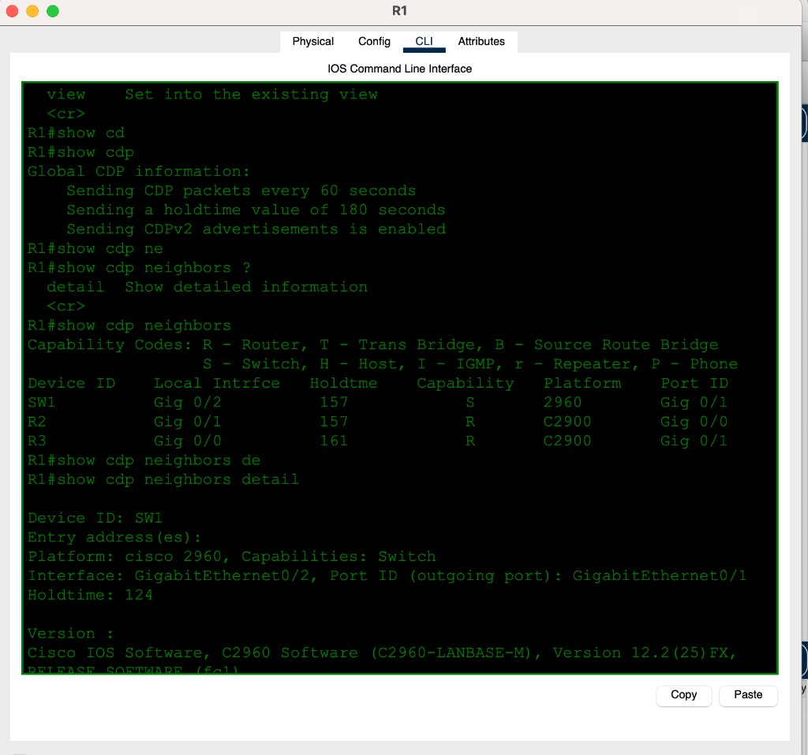
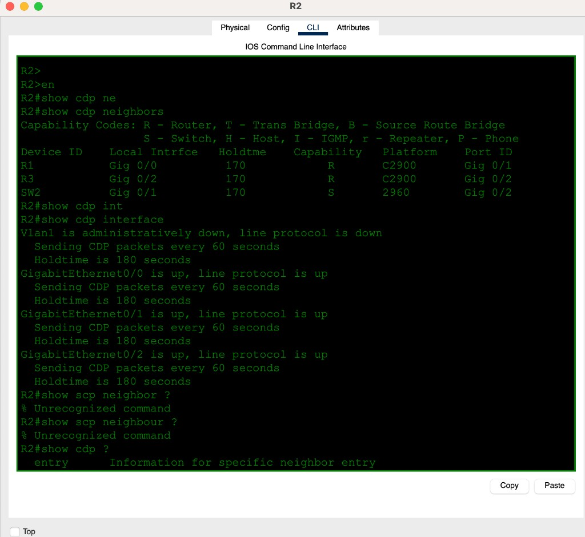
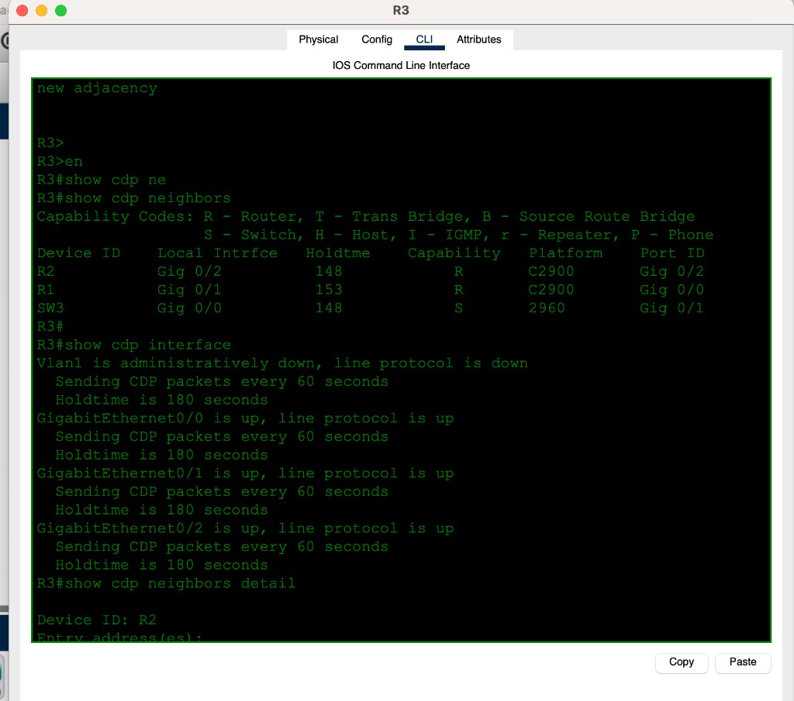
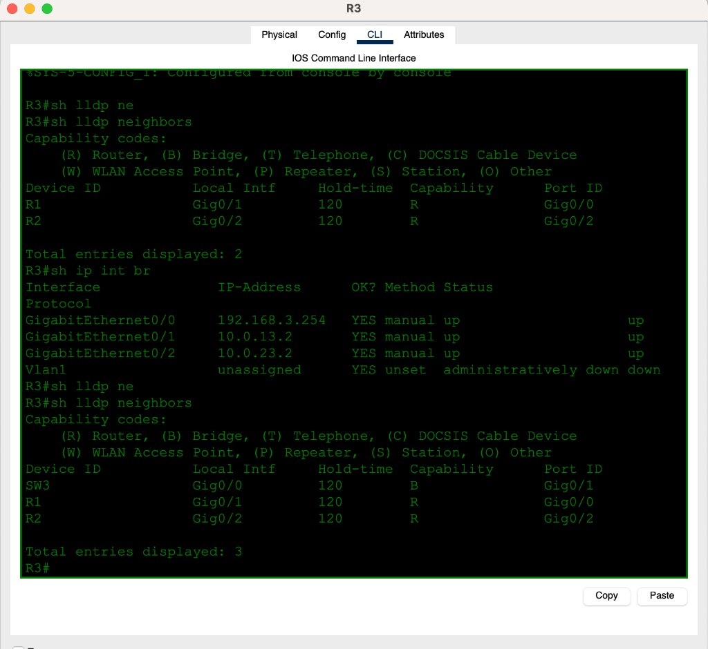
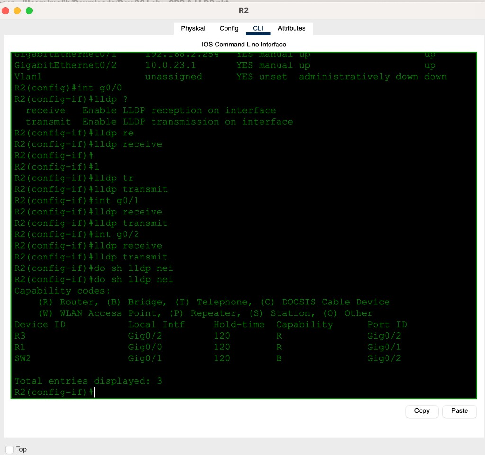
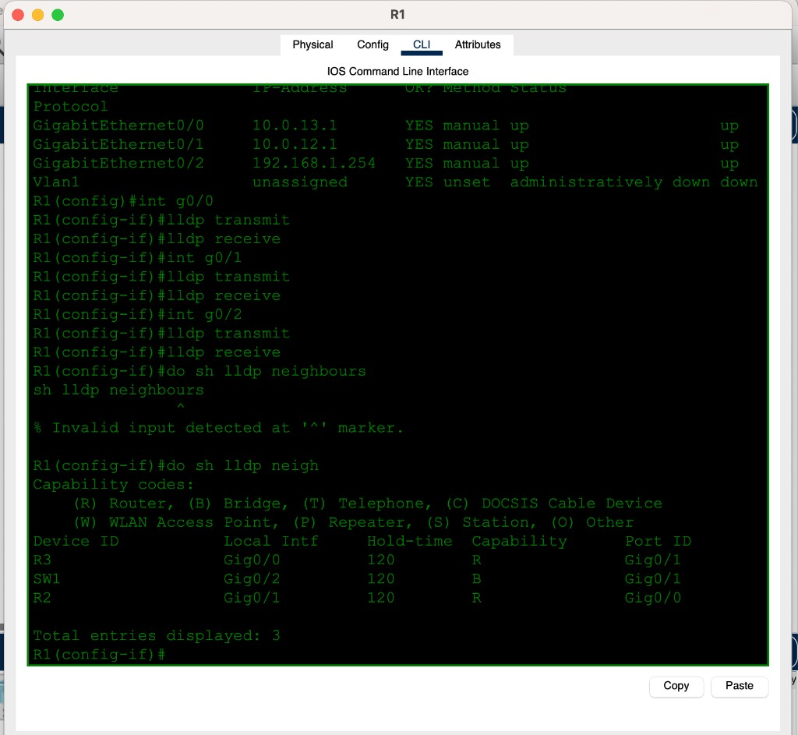
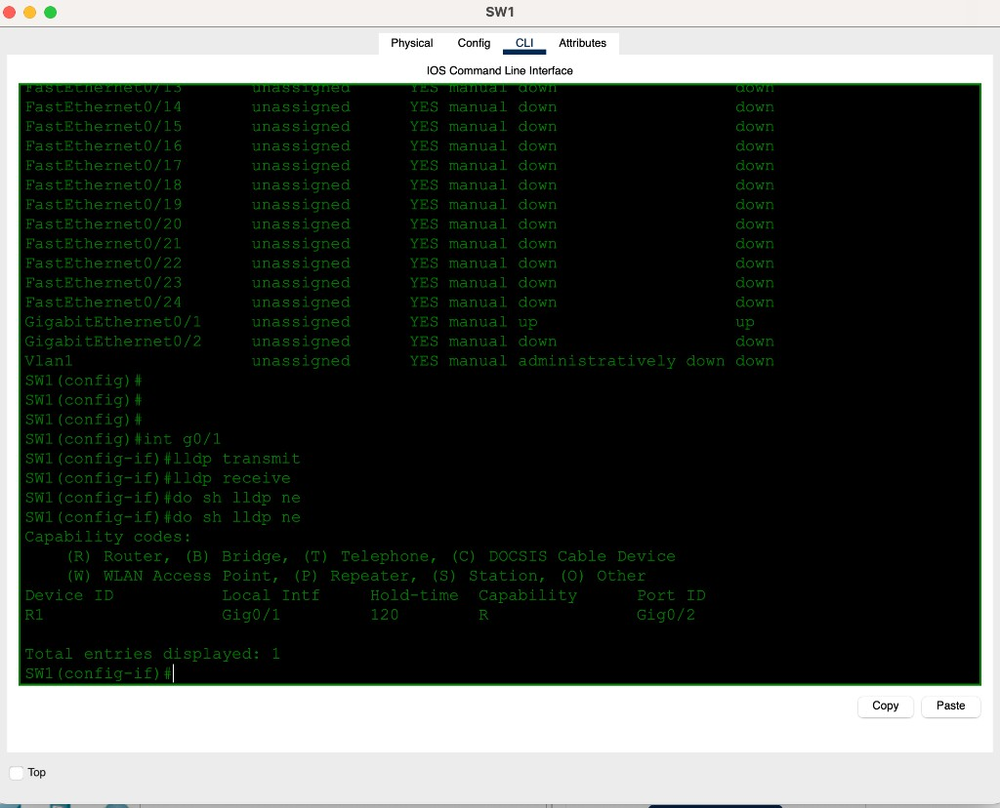
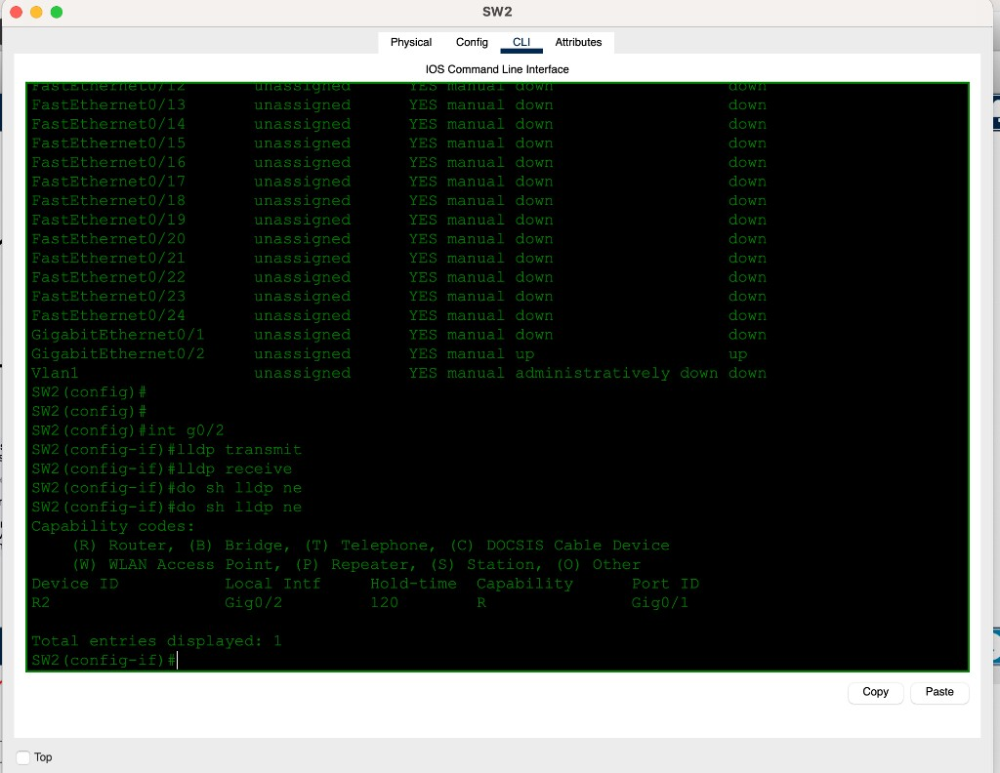
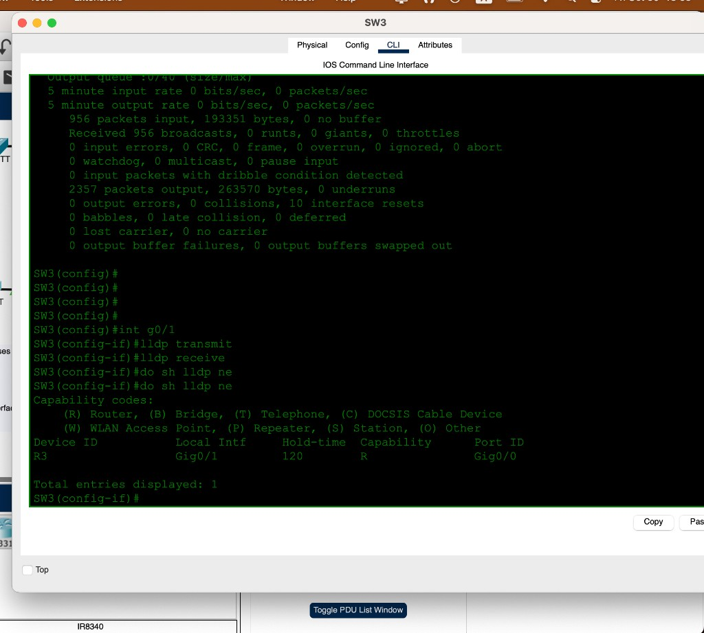

# Day 36 — CDP & LLDP

**Topic:** Cisco Discovery Protocol (CDP) vs Link Layer Discovery Protocol (LLDP)
**Simulator:** Cisco Packet Tracer — `Day 36 Lab - CDP & LLDP.pkt`
**Course reference:** Jeremy's IT Lab — CCNA 200-301, Day 36

---

## 🎯 Objective

> Use **CDP** (on by default) to map unlabeled links, then turn on **LLDP** so the same neighbors show up in the IEEE table. Switches need LLDP on the uplink too, or they stay invisible.

## 🗺️ Topology

Three 2911 routers in a triangle, three 2960 switches, one PC per LAN. Links start **unlabeled** — CDP is how you fill in IPs and interface IDs.

**Tasks:**

1. Use CDP (and other commands) to identify and label missing IPs and interface IDs.
2. Disable CDP on the switch interfaces connected to PCs (`no cdp enable`).
3. Disable CDP globally on each device (`no cdp run`).
4. Enable LLDP globally, and enable Tx/Rx on interfaces to other network devices (`lldp transmit` / `lldp receive` — Tx/Rx starts **off**).



Mapped from `show cdp neighbors`:

| Local | Iface | Neighbor | Neighbor iface | Subnet |
|-------|-------|----------|----------------|--------|
| R1 | G0/0 `10.0.13.1` | R3 | G0/1 `10.0.13.2` | `10.0.13.0/30` |
| R1 | G0/1 `10.0.12.1` | R2 | G0/0 | `10.0.12.0/30` |
| R1 | G0/2 `192.168.1.254` | SW1 | G0/1 | `192.168.1.0/24` |
| R2 | G0/1 `192.168.2.254` | SW2 | G0/2 | `192.168.2.0/24` |
| R2 | G0/2 `10.0.23.1` | R3 | G0/2 `10.0.23.2` | `10.0.23.0/30` |
| R3 | G0/0 `192.168.3.254` | SW3 | G0/1 | `192.168.3.0/24` |



## 🧠 Lesson

**CDP** = Cisco-only, **on** globally and per interface by default. Timer **60 s**, holdtime **180 s**, CDPv2.

**LLDP** = IEEE 802.1AB, **off** on Cisco until you enable it. Timer **30 s**, holdtime **120 s**.

```
show cdp neighbors          ! brief: ID, local iface, holdtime, capability, platform, Port ID
show cdp neighbors detail   ! IP, IOS version, native VLAN, duplex
show cdp interface          ! which ifaces are sending CDP
show lldp neighbors
```

Capability: **R** router, **S** switch (CDP) / **B** bridge (LLDP). **Port ID** is the *neighbor's* interface.

IOS wants American spelling: `neighbors`, not `neighbours`.

## 🛠️ Configuration

### 1 — Map with CDP (already running)

R2: R1 on G0/0, R3 on G0/2, SW2 (2960) on G0/1. `show scp neighbor` is not a command.





`show cdp neighbors detail` on R1 for SW1: platform 2960, local G0/2 ↔ SW1 G0/1, IOS version.

### 2 — Enable LLDP on the routers

Per interface (Packet Tracer 2911):

```
interface g0/0
 lldp transmit
 lldp receive
interface g0/1
 lldp transmit
 lldp receive
interface g0/2
 lldp transmit
 lldp receive
```

Global equivalent on real IOS: `lldp run`.

R3 first `show lldp neighbors` listed **only R1 and R2** — SW3 had not been enabled yet. After the switch uplink, **3** entries.





`do sh lldp neighbours` fails (`^` under the **u**). `show lldp neighbors` works — R3, SW1, R2.



### 3 — Enable LLDP on switch uplinks

Same two commands on the port toward the router. Without this, routers never learn the 2960 over LLDP.

```
! SW1 G0/1 → R1 G0/2
interface g0/1
 lldp transmit
 lldp receive

! SW2 G0/2 → R2 G0/1
interface g0/2
 lldp transmit
 lldp receive

! SW3 G0/1 → R3 G0/0
interface g0/1
 lldp transmit
 lldp receive
```







## ✅ Verification

| Check | Expected |
|-------|----------|
| `show cdp neighbors` | three neighbors per router (two routers + one switch) |
| `show cdp interface` | G0/0–G0/2 up, CDP every 60 s / hold 180 |
| `show lldp neighbors` (routers) | same three after switch LLDP is on |
| Switch `show lldp neighbors` | one entry: the attached router |
| `show lldp neighbours` | `% Invalid input` — use `neighbors` |

## 💡 What I learned

CDP is already drawing the unlabeled topology; LLDP is the standards version of the same idea and starts **empty** until you enable it on **both** ends. A switch that only has CDP will not appear in `show lldp neighbors`. Holdtime in the LLDP table is **120**, not CDP's 180. CLI spelling is US English.

## 📎 Files in this lab

- `README.md` — this writeup
- `day36-cdp-lldp.pkt` — Packet Tracer save
- `day36-topology.png` — unlabeled topology + tasks (main photo)
- `day36-r1-cdp.png` — CDP neighbor map
- `day36-r2-cdp.png` / `day36-r3-cdp.png`
- `day36-r1-lldp.png` / `day36-r2-lldp.png` / `day36-r3-lldp.png`
- `day36-sw1-lldp.png` / `day36-sw2-lldp.png` / `day36-sw3-lldp.png`
