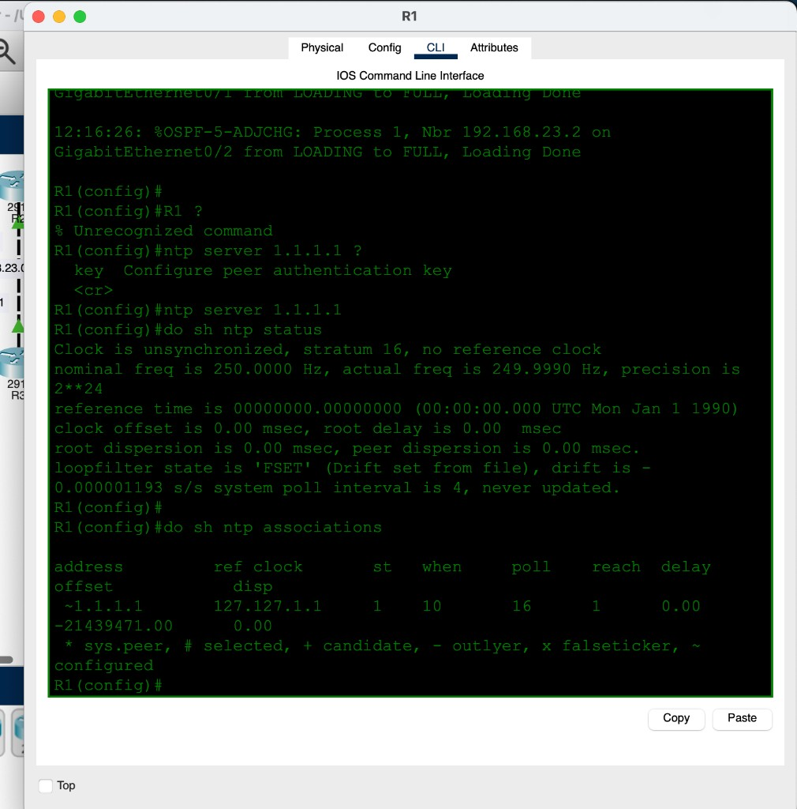
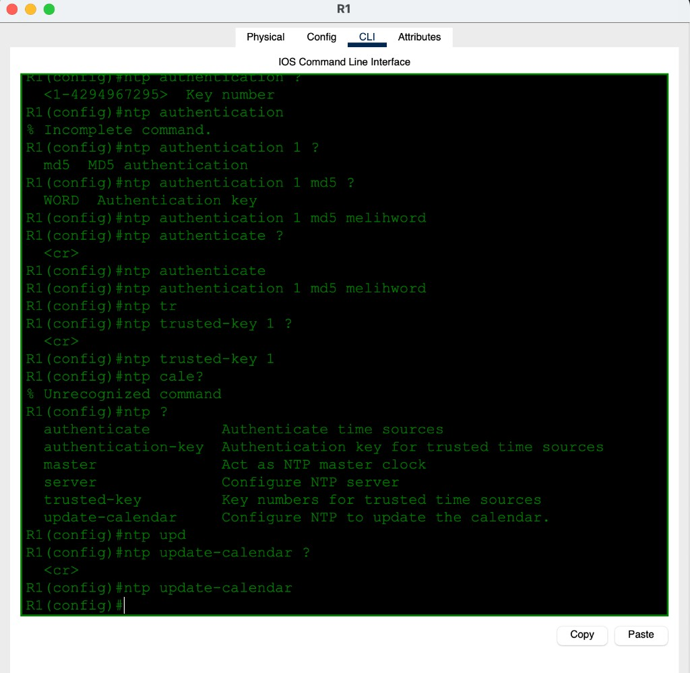
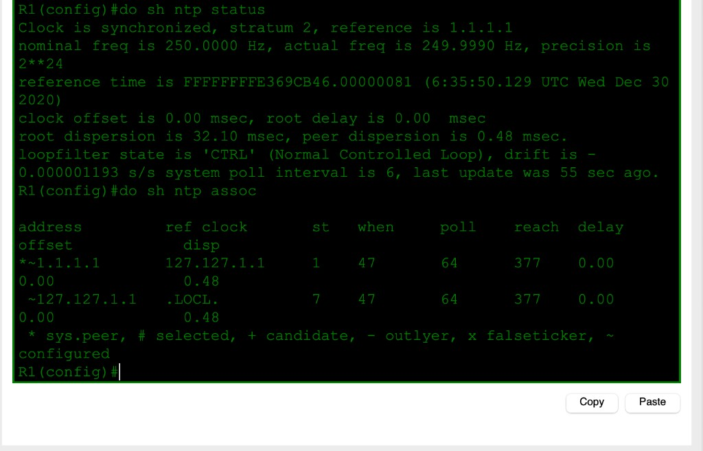
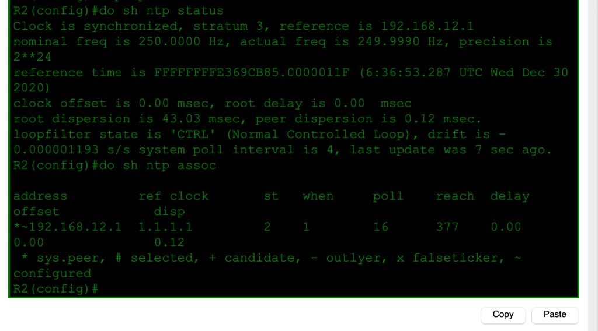
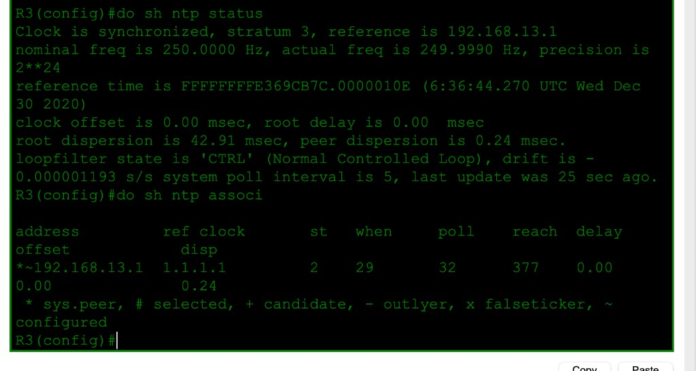

# Day 37 — NTP

**Topic:** Network Time Protocol — client, MD5 auth, stratum, `update-calendar`
**Simulator:** Cisco Packet Tracer — `Day 37 Lab - NTP.pkt`
**Course reference:** Jeremy's IT Lab — CCNA 200-301, Day 37

---

## 🎯 Objective

> Sync **R1** to the Internet NTP server `1.1.1.1`, then sync **R2** and **R3** to R1 with **NTP authentication**. Hardware calendars follow with `ntp update-calendar`.

## 🗺️ Topology

Three routers, OSPF already up (FULL on R1 G0/1 / G0/2). NTP path:

| Device | NTP server | Resulting stratum |
|--------|------------|-------------------|
| R1 | `1.1.1.1` (Internet) | **2** |
| R2 | `192.168.12.1` (R1) | **3** |
| R3 | `192.168.13.1` (R1) | **3** |

No annotated topology screenshot in this upload — CLI is the evidence.

## 🧠 Lesson

NTP stratum = hops from a reference clock. Stratum **16** = unsynchronized. A client is **server stratum + 1**.

`show ntp associations` flags: `*` selected, `~` configured, `377` reach = eight good polls (octal).

Auth is three pieces, all required:

```
ntp authentication-key 1 md5 <key>
ntp authenticate
ntp trusted-key 1
ntp server <IP> key 1
```

`ntp server 1.1.1.1 melihword` is invalid — the password belongs in `authentication-key`, the server line takes **`key <number>`**.

## 🛠️ Configuration

### 1 — R1 to the Internet clock (unsync at first)

```
ntp server 1.1.1.1
```

Right after: **Clock is unsynchronized, stratum 16**. Association `reach 1` — first poll only. Wait for NTP.



Then auth + calendar:

```
ntp authentication-key 1 md5 melihword    ! lab-only key
ntp authenticate
ntp trusted-key 1
ntp update-calendar
```



### 2 — R2 / R3 to R1 (not to 1.1.1.1)

Same key on every box. First attempt `ntp server 1.1.1.1 key 1` was removed — those routers should take time from **R1**.

```
! R2
ntp authentication-key 1 md5 melihword
ntp authenticate
ntp trusted-key 1
ntp server 192.168.12.1 key 1
ntp update-calendar

! R3
ntp authentication-key 1 md5 melihword
ntp authenticate
ntp trusted-key 1
ntp server 192.168.13.1 key 1
ntp update-calendar
```


### 3 — Synced

| Router | `show ntp status` | Association |
|--------|-------------------|-------------|
| R1 | synchronized, **stratum 2**, ref `1.1.1.1` | `*~1.1.1.1` st **1**, reach 377 |
| R2 | synchronized, **stratum 3**, ref `192.168.12.1` | `*~192.168.12.1` ref `1.1.1.1` st **2** |
| R3 | synchronized, **stratum 3**, ref `192.168.13.1` | `*~192.168.13.1` ref `1.1.1.1` st **2** |







## ✅ Verification

| Check | Expected |
|-------|----------|
| R1 `show ntp status` | synchronized, stratum 2, reference `1.1.1.1` |
| R2 / R3 `show ntp status` | synchronized, stratum 3, reference R1 |
| `show ntp associations` | `*` on the configured server, **reach 377** |
| Auth mismatch / wrong server | stays stratum 16 |

## 💡 What I learned

Stratum 16 means “I have a server line but I am **not** in sync yet” — wait, or the server is wrong. R2/R3 should **not** point at `1.1.1.1`; they point at R1 and inherit stratum 3. NTP auth is key + `authenticate` + `trusted-key` + `server … key N`. `reach 377` is the healthy poll bitmask.

## 📎 Files in this lab

- `README.md` — this writeup
- `day37-ntp.pkt` — Packet Tracer save
- `day37-r1-unsync.png` — stratum 16 before sync
- `day37-r1-auth.png` / `day37-r2-auth.png` / `day37-r3-auth.png`
- `day37-r1-sync.png` / `day37-r2-sync.png` / `day37-r3-sync.png`
