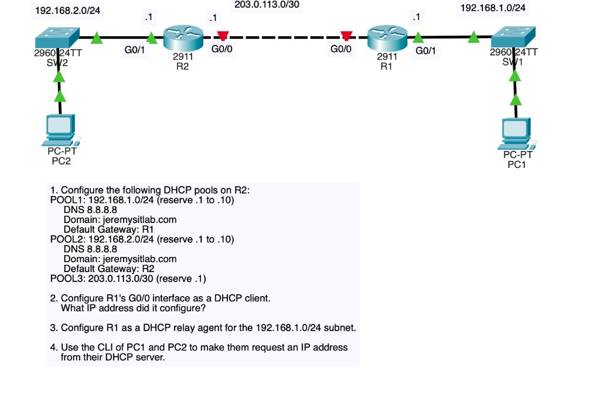
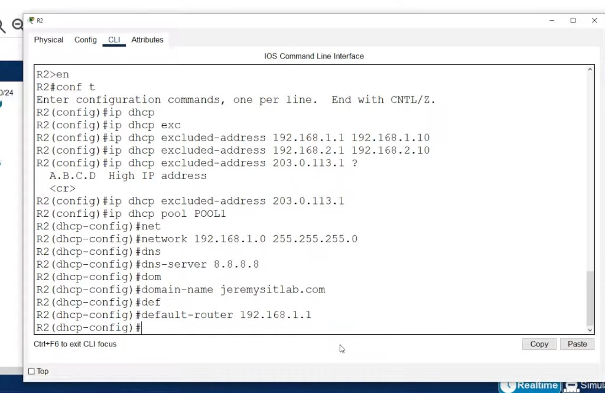

# Day 39 — DHCP

**Topic:** IOS DHCP server, DHCP client, relay (`ip helper-address`)
**Simulator:** Cisco Packet Tracer — `Day 39 Lab - DHCP.pkt`
**Course reference:** Jeremy's IT Lab — CCNA 200-301, Day 39

---

## 🎯 Objective

> R2 is the **DHCP server** for three pools. R1’s WAN is a **DHCP client**, and R1 **relays** Discover from PC1’s LAN to R2. Then PC1/PC2 `ipconfig /renew`.

## 🗺️ Topology

PC2 — SW2 — R2 G0/1 `192.168.2.1/24` · R2 G0/0 `203.0.113.1/30` — R1 G0/0 (DHCP) · R1 G0/1 `192.168.1.1/24` — SW1 — PC1

**Tasks:**

1. Three pools on **R2** (reserve `.1–.10` on the `/24`s, reserve `.1` on the `/30`).
2. R1 G0/0 = DHCP client — expected address **`203.0.113.2`** (only host left in the `/30`).
3. R1 = relay for `192.168.1.0/24`.
4. PC1 and PC2 request addresses from the server.



## 🧠 Lesson

DHCP is **DORA**: Discover → Offer → Request → Ack (UDP **67** server / **68** client). Broadcasts do **not** cross a router, so a remote LAN needs **`ip helper-address`** on the **client-facing** interface. That turns Discover into a unicast to the server.

```
ip dhcp excluded-address LOW [HIGH]   ! never hand these out
ip dhcp pool NAME
 network PREFIX MASK
 default-router GATEWAY
 dns-server 8.8.8.8
 domain-name example.com
interface g0/0
 ip address dhcp                      ! this router is a client
interface g0/1
 ip helper-address SERVER             ! this router is a relay
```

First free address after `.1–.10` excluded is **`.11`**.

## 🛠️ Configuration

### 1 — R2 DHCP server

```
ip dhcp excluded-address 192.168.1.1 192.168.1.10
ip dhcp excluded-address 192.168.2.1 192.168.2.10
ip dhcp excluded-address 203.0.113.1

ip dhcp pool POOL1
 network 192.168.1.0 255.255.255.0
 dns-server 8.8.8.8
 domain-name jeremysitlab.com
 default-router 192.168.1.1

ip dhcp pool POOL2
 network 192.168.2.0 255.255.255.0
 dns-server 8.8.8.8
 domain-name jeremysitlab.com
 default-router 192.168.2.1

ip dhcp pool POOL3
 network 203.0.113.0 255.255.255.252
```

POOL1 gateway is **R1** (`192.168.1.1`). POOL2 gateway is **R2** (`192.168.2.1`). POOL3 has no extra gateway line in the lab text — R2 already owns `203.0.113.1`.



### 2 — R1 G0/0 as DHCP client

```
interface g0/0
 ip address dhcp
 no shutdown
```

`show ip interface brief` → **`203.0.113.2`**.

### 3 — R1 relay for PC1’s LAN

Helper goes on **G0/1** (the LAN with the clients), pointing at **R2** `203.0.113.1` — not the WAN toward the server.

```
interface g0/1
 ip helper-address 203.0.113.1
```

PC2 does not need a relay: it shares `192.168.2.0/24` with the server.

### 4 — PCs request leases

```
ipconfig /renew
ipconfig
```

Expected: PC1 `192.168.1.11`, PC2 `192.168.2.11`, DNS `8.8.8.8`, domain `jeremysitlab.com`.

## ✅ Verification

| Check | Expected |
|-------|----------|
| R2 `show ip dhcp pool` / `show ip dhcp binding` | leases for R1, PC1, PC2 |
| R1 G0/0 | `203.0.113.2` via DHCP |
| R1 `show ip interface g0/1` | Helper address `203.0.113.1` |
| PC1 / PC2 `ipconfig` | `.11` in their `/24`, GW `.1`, DNS `8.8.8.8` |

CLI evidence in this folder is the topology + R2 POOL1 config. Bindings / PC renews live in the `.pkt`.

## 💡 What I learned

One IOS box can serve **several** `network` statements (one pool per subnet). Exclude the router IPs or DHCP will try to give them away. **`ip address dhcp`** is the client side. **`ip helper-address`** is on the interface that **hears the broadcast**, with the **server unicast** as the argument. Without the relay, PC1’s Discover dies on R1.

## 📎 Files in this lab

- `README.md` — this writeup
- `day39-dhcp.pkt` — Packet Tracer save
- `day39-topology.png` — topology + tasks (main photo)
- `day39-r2-pool.png` — R2 excluded-address + POOL1
